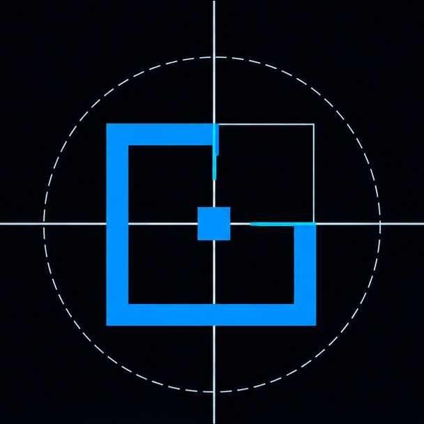
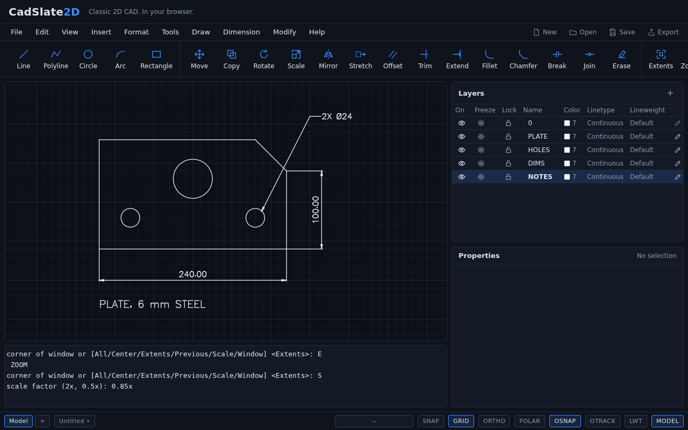

<p align="center"></p>

# CadSlate2D

**Classic 2D CAD. In your browser.**

CadSlate2D is a free, browser-native, local-first 2D CAD program in the spirit of classic command-driven drafting: a command line with the classic commands and aliases, precise coordinate entry, object snaps and tracking, grips, layers, blocks, dimensions, hatches, layouts, and DXF files. No installation, no account, no cloud: the page is static, and your drawings never leave your browser and the files you choose.



- **Free software:** [AGPL-3.0-or-later](LICENSE). Use it, study it, change it, share it.
- **Try it:** `make install && make dev` and open the page Vite prints (see [Development](#development)). There is no hosted instance yet.
- **Contribute:** start from an issue; see [`CONTRIBUTING.md`](CONTRIBUTING.md).
- **Security:** report vulnerabilities privately; see [`SECURITY.md`](SECURITY.md).
- **The AI assistant** planned for the program (natural language as one more way to type commands) is optional and will run against a separately licensed hosted service kept in its own repository; the program itself never needs it.

The visual target the look follows is [`visual_identity.png`](visual_identity.png).

## Status

Milestones **M0 to M14**, **M16**, **M17** (multileaders), and **M18** (the classic menu bar) are complete. The [M14 review](docs/reviews/m14-exit-review.md) finds the product complete for its purpose: the classic daily drafting commands and every item of a successful v1 (DESIGN §47). **M2** is implemented but waits for a hands-on assessment by someone with classic CAD experience ([review](docs/reviews/m2-exit-review.md)).

You can do all of this in a static page with no backend:
- draw by command or pointer, with object snaps, tracking, ORTHO, POLAR, grid snap, and grips;
- modify with the classic set;
- organize with layers, layer states, blocks, groups, and draw order;
- annotate with text, styles, dimensions of every kind, leaders, hatches, and wipeouts;
- lay out sheets with viewports and plot them to PDF;
- exchange DXF and DWG (AutoCAD 2000, 2004, 2007/2008), with what is not held reported;
- undo everything, and recover after a crash;
- optionally, say what to draw or change in plain words, in the AI Assistant panel, and accept or reject what it proposes.

The tables below list the commands; what each modify command does to each kind of object is in [`docs/modify-matrix.md`](docs/modify-matrix.md).

What remains, **M15**, is verification that needs a person: real GPUs, WebKit, and a check of the DXF, the DWG, and the PDF in AutoCAD and a desktop viewer. See the [milestones](https://github.com/cadslate2d/cadslate2d/milestones) and [issues](https://github.com/cadslate2d/cadslate2d/issues).

## What works today

Type anywhere on the page; you never need to click the command line first. The menu bar, the toolbar, and the panels are optional ways to type:
- every menu item and button runs the same command you could type ([ADR-0034](docs/adr/0034-menu-macros.md)). A menu item may wait for your answer before typing the rest, as AutoCAD's menus do;
- a Layers panel action is `LAYER` with its answers, a change in the Properties panel is `CHPROP`, and the log shows each step;
- View shows and hides the toolbar and the panels.

The menu bar has the menus of AutoCAD 2007/2008's classic workspace, in its order: **File, Edit, View, Insert, Format, Tools, Draw, Dimension, Modify, Help**. Each command sits where that program puts it, for example Draw › Arc › Start, Center, End, or Format › Layer Tools › Layer Off. Items AutoCAD has and this program does not are left out rather than shown dead. Items that cannot apply now are greyed: Undo with nothing to undo, Paste with nothing to paste, the viewport items off a layout. From the keyboard, as in AutoCAD:
- Alt and a letter opens a menu (Alt+F File, Alt+O Format, Alt+D Draw, Alt+N Dimension, …), and Alt alone underlines the letters;
- the arrows walk the menus and their cascades, a letter runs what it underlines, and Esc closes one level.

The keys the menus show work: Ctrl+O, Ctrl+S, Ctrl+Shift+S (save as), Ctrl+P (plot), Ctrl+Z, Ctrl+Y, Ctrl+X, Ctrl+C, Ctrl+V, Del, and Ctrl+A (everything, at the idle prompt).

| Command | Aliases | What it does |
| --- | --- | --- |
| `LINE` | `L` | A chain of line segments. Options: `Close`, `Undo`. |
| `CIRCLE` | `C` | Centre and radius, or `Diameter`, `2P`, `3P`. |
| `ARC` | `A` | Three points; or start, `Center`, end; or start, centre, `Angle`. |
| `ELLIPSE` | `EL` | An ellipse by the two ends of one axis and the half-length of the other — typed, or a point that far from the centre; the longer axis is always the major one — or `Center` then an axis end; `Arc` makes an arc of one, by start and end parameters in degrees or by points; with the isometric snap style, `Isocircle` draws the circle of the current isometric plane by its centre and radius or `Diameter`, as the ellipse it is (#336). An ellipse is read as chords, a third of a thousandth of its major axis from the curve: it snaps at its centre, axis ends, and an arc's ends and middle, is picked on its curve, moves, turns, scales, mirrors, stretches whole, breaks and trims by parameter, cuts other objects, and bounds a hatch; it is not offset, filleted, extended, joined, or exploded. |
| `SPLINE` | `SPL` | A cubic spline through the points given in order, `Undo` taking the last back, Enter finishing after at least two. It is read as chords, flat to a quarter of a thousandth of its extent: it snaps at its ends and middle, is picked on its curve, moves, turns, scales, and mirrors, stretches by its fit points and re-fits, grips at its fit points, cuts other objects, and bounds a hatch when it ends where it began; it is not trimmed, broken, extended, offset, filleted, joined, or exploded. A spline from a file keeps its control points, knots, and weights as written. |
| `PLINE` | `PL` | One polyline through a chain of points. `Arc` switches to arc segments that continue smoothly from the one before; `Line` switches back. Also `Close`, `Undo`. |
| `DONUT` | `DO`, `DOUGHNUT` | A filled ring at each centre given, until Enter: an inside and an outside diameter; zero inside makes a filled disc. A closed polyline of two half-turn arcs with the width between the diameters. |
| `RECTANG` | `REC` | A closed rectangle from two corners. |
| `XLINE` | `XL` | Construction lines, endless both ways: through a point and each point after it, or `Hor`, `Ver`, `Ang` (at an angle) through each point, `Bisect` an angle by its vertex and two points, or `Offset` a line, an xline, or a ray by a distance or `Through` a point. Until Enter; one undo. They count nowhere in the extents, so `ZOOM Extents` ignores them; on screen they are drawn clipped to the view in the theme's entity colour, on the page with their own look ([ADR-0031](docs/adr/0031-construction-lines.md)). `TRIM` and `BREAK` turn an xline into rays and a ray into a line. |
| `RAY` | — | Construction lines endless one way: from a start point through each point after it, until Enter. |
| `POLYGON` | `POL` | A regular polygon as a closed polyline: a number of sides, a centre, `Inscribed in circle` (the corners on the circle) or `Circumscribed about circle` (the sides touching it), and the radius — typed, or a point that puts a corner (or a side's middle) there; or `Edge`, by two points, the rest turning counter-clockwise. |
| `POINT` | `PO` | A point at each place given, until Enter: a place that `DIVIDE` and `MEASURE` mark and the `Node` snap finds. Drawn as the drawing's point style. |
| `DIVIDE` | `DIV` | Points along a curve — a line, arc, circle, ellipse, spline, or polyline, its arcs included — dividing it into so many segments of equal length; on a closed curve the start is marked too. The points take the curve's layer and properties. |
| `MEASURE` | `ME` | Points every so far along a curve, from the end nearest where it was picked. |
| `PTYPE` | `DDPTYPE` | How every point is drawn: `Dot`, `Cross`, `X`, `Tick`, or `Blank`, with `CIrcle` or `SQuare` round it (`Plain` takes the ring off), or the `$PDMODE` number itself; then the size, in drawing units. One undoable change that redraws every point. A size relative to the screen is not held: a file's zero or negative `$PDSIZE` opens at the default size. |
| `COLOR` | `COL` | The colour new objects are given: a number from 1 to 255, a name (`red`, `yellow`, `green`, `cyan`, `blue`, `magenta`, `white`), `ByLayer` (the default), or `ByBlock`. An object with a colour of its own keeps it whatever its layer's colour becomes. There is no true colour: a file that has one opens with the nearest numbered colour, and says so ([ADR-0018](docs/adr/0018-dxf-release-r2000.md), amended). |
| `LWEIGHT` | `LW` | The lineweight new objects are given: one of the standard widths in millimetres (`0.25`, `0.5`, `1`, … `2.11`), `Default`, `ByLayer` (the default), or `ByBlock`. Lineweights are shown only while `LWT` on the status bar is on. |
| `UNITS` | `UN` | Says what the drawing's numbers are: unitless (the default), millimetres, centimetres, metres, inches, or feet. Nothing is rescaled; the unit is what a typed `25mm` is converted into, and it is saved with the drawing. |
| `DIMSTYLE` | `D`, `DST` | Dimension styles from the command line: `New` copies the current style under a new name and makes it current, `Set` chooses the current one, `Rename` and `Delete` (not `Standard`, not the current one), `?` to list; `Height`, `Arrow`, `Gap`, `Offset`, `Extension`, `Baseline` (the spacing of a baseline chain), `Precision`, and `SUffix` change one value of the current style, with the current value as the default; `SCale` (DIMSCALE, #327) multiplies every size it draws — text, arrows, gaps, extension lines — and never the value, so a style made for millimetres reads on a drawing in centimetres or metres. |
| `DIMLINEAR` | `DLI` | A horizontal or vertical dimension: two extension-line origins — or Enter and a picked line or arc, whose ends they are — then where the dimension line goes, previewed at the pointer; horizontal or vertical by where the pointer is, or `Horizontal`, `Vertical`, or `Rotated` and an angle; `Text` puts words in place of the value, `Angle` turns the text. The dimension is drawn by the current dimension style ([ADR-0020](docs/adr/0020-dimensions.md)) and redrawn whenever the style changes; its grips are the points it measures and where it is placed. |
| `DIMALIGNED` | `DAL` | The same, measured along the two points. |
| `DIMANGULAR` | `DAN` | The angle of a corner: pick an arc (its centre and ends), a circle (its centre, the pick, and a second point), or two lines (where they meet, and whichever of the four angles the pointer is in) — or Enter and a vertex and two points — then where the dimension arc goes; the text is degrees to the style's decimals. `Text` and `Angle` as for `DIMLINEAR`. |
| `DIMRADIUS`, `DIMDIAMETER` | `DRA`, `DDI` | Pick an arc or a circle, then where the text goes, which also sets the leader's angle: `R` or `Ø` before the value; the text sits along the leader inside the circle, or outside at the end of a leader when it does not fit. |
| `DIMORDINATE` | `DOR` | An ordinate dimension: the X or the Y of a feature from the datum, with a leader to where its text goes. The axis is the X when the leader is dragged up or down, the Y when across, or as `Xdatum` and `Ydatum` say; the leader jogs across when its end is not in line with the feature. The datum is the origin until `Datum` moves it, for the session. `Text` and `Angle` as for the other dimensions. |
| `QDIM` | | A row of dimensions at once: the ends and centres of the selected lines, arcs, circles, polylines, and points, dimensioned along the line placed — horizontal when placed above or below them, vertical when beside. `Continuous` (the default) chains them, `Baseline` measures each from the first or from a `Datum point` with every line the style's baseline spacing further out, `Ordinate` gives each its ordinate from the datum. Previewed at the pointer; one undo. |
| `DIMBASELINE` | `DBA` | A run of dimensions from one baseline: from the newest dimension's first extension line, or from the extension line nearer the pick of one selected (`Select`, or Enter), each next point makes a dimension of the same kind and style — linear at its angle, aligned, or angular about its vertex — its line the style's baseline spacing further out than the last; `Undo` takes the last back; Enter twice ends. A radius or diameter dimension cannot be chained. One undo for the run. |
| `DIMCONTINUE` | `DCO` | A run of dimensions end to end: as `DIMBASELINE`, but from the newest dimension's second extension line, each one sharing the dimension line (or arc) and running on from the last. |
| `LEADER` | `LE`, `LEAD` | A leader: points until Enter, the first the arrowhead's tip (`Undo` takes the last back), then the note, or Enter for none. Laid out by the current dimension style — the arrowhead's size, the note's height and gap, a landing before the note, which reads to the right or the left as the leader ends — and redrawn when the style changes. Grips at every vertex; `TEXTEDIT` edits the note. |
| `MLEADER` | `MLD` | A multileader ([ADR-0033](docs/adr/0033-multileaders.md)): the arrowhead's tip, the landing, then the note, or Enter for none. `Content` at the first prompt makes the note a `Block` (by name, previewed with the leader), words (`Mtext`), or `None`; a style that names a block starts with it. Laid out by the current multileader style — the arrowhead's size, a dogleg from the landing toward the side away from the leaders, then the words past the gap at the style's height, or the block with its nearer side's middle at the dogleg's end — and redrawn when the style or the block changes; never stored. Grips at each leader's points and the landing; the tips are endpoints to snap to. Read and written as DXF `MULTILEADER`, its style as a `MLEADERSTYLE`; a file's second leader root is brought to the first's landing and reported. |
| `MLEADEREDIT` | `MLE` | Leaders on a picked multileader: each point is the arrowhead of a new leader to its landing, previewed, until Enter; `Remove leader` takes the one nearest each point instead. A multileader keeps its last leader. One undo. |
| `MLEADERSTYLE` | `MLS` | The multileader styles, as `DIMSTYLE` is for dimensions: `New` from the current style and made current, `Set`, `Rename`, `Delete` (not `Standard`, the current one, or one in use), `?` to list; `Arrow`, `Gap`, `DOgleg` (0 for none), `Height`, `Block` (the block new notes are, `.` for words), and `SCale` (a new block note's scale) change the current style, and every multileader drawn by it follows. |
| `HATCH` | `H` | Fills a region, solid or with a pattern ([ADR-0021](docs/adr/0021-filled-regions.md)): pick a point inside it — the smallest closed loop around the point is the boundary (a closed polyline, a circle, or lines, arcs, and open polylines that meet end to end), and the loops inside it are holes and islands — or `Select` the boundary objects. `Pattern` chooses `SOLID` or one of the classic patterns (`ANSI31`–`ANSI38`, `BRICK`, `DOTS`, `EARTH`, `GRASS`, `HONEY`, `LINE`, `NET`, `NET3`, `STEEL`; `?` lists them), `Angle` and `SCale` place it; the session remembers them for the next HATCH. A pattern's lines are clipped to the region and stay put as the view zooms; one too fine for its region is refused. Previewed at the pointer; one hatch, one undo. A hatch is picked by its fill, moves whole, and is refused by the curve commands; lines that cross without meeting bound nothing yet. |
| `BOUNDARY` | `BO` | The loop `HATCH` would fill round a picked point, drawn as a closed polyline on the current layer, its arcs as bulges — with the loops inside it too while `Islands` is on (the default). Points until Enter; one undo. |
| `HATCHEDIT` | `HE` | Changes a picked hatch's `Pattern`, `Angle`, or `SCale` until Enter; one undo for the lot. A solid fill has no angle or scale. |
| `LINETYPE` | `LT` | Linetypes from the command line: `Load` one of the built-in patterns (`Dashed`, `Hidden`, `Center`, `Phantom`, `Dot`, `Dashdot`), `Set` the linetype new objects are given (a loaded name, `ByLayer`, or `ByBlock`), `Delete` one nothing uses, and `?` to list. |
| `LTSCALE` | `LTS` | What every linetype pattern is multiplied by. Patterns are defined in drawing units — a `Dashed` dash is 0.5 — so a drawing in millimetres wants a larger scale than one in metres. |
| `TEXT` | `DT` | A single line of text: start point (or `Justify` first: `Left`, `Center`, `Right`), height — not asked when the current text style fixes one — rotation, then the text itself — spaces and all; Enter with nothing typed makes no text. It takes the current style's width factor and slant, and keeps them when the style changes later. Drawn with a stroke font, sharp at every zoom ([ADR-0016](docs/adr/0016-text-rendering.md)). |
| `STYLE` | `ST` | Text styles from the command line: `New` copies the current style under a new name and makes it current, `Set` chooses the current one, `Rename` and `Delete` (not `Standard`, not the current one, not one a text has), `?` to list; `Height` (zero to ask each time), `Width` factor, and `Oblique` angle change what the current style gives a new text. A text already made keeps its own width and slant. |
| `MTEXT` | `MT`, `T` | A paragraph: two corners give the top left and the width (`Height` sets the text height first), then the words in a small editor — Enter breaks the line, Ctrl+Enter or OK finishes, Escape cancels. Lines wrap at spaces to the width; a word wider than the width stands alone. |
| `TEXTEDIT` | `ED` | Changes what a picked text says; Enter keeps the old text. On a paragraph it reopens the editor with the words. |
| `BLOCK` | `B` | Makes a block out of the selection: a name, a base point, and the objects, which are replaced by one reference to the new block. The objects keep their properties inside the definition; a line on layer `0`, or with a `ByBlock` colour, is drawn as each reference is. A name already taken asks before the block is redefined — and then every reference to it changes ([ADR-0017](docs/adr/0017-blocks.md)). |
| `INSERT` | `I` | Places a block: its name (`?` lists them), the insertion point, a scale factor, and a rotation angle, previewed at the pointer. A block whose definition holds attribute definitions asks for each value in turn, with the definition's prompt and default; Enter takes the default. `~` at the name picks a DXF file instead: its model becomes a block named after the file — its layers, linetypes, styles, and blocks brought in by name, the drawing's own row kept where a name is taken — and is placed; a file inserted again places the block it made. |
| `WBLOCK` | `W` | Writes a block, by name, or the selection, about a base point, as a DXF file of its own, with every row its objects refer to, to a file the user chooses. The objects stay. |
| `COPYCLIP`, `CUTCLIP`, `COPYBASE`, `PASTECLIP` | Ctrl+C, Ctrl+X, Ctrl+V | The drawing's clipboard, the session's own rather than the system's: the selection copied, or cut as one undo, about its lower left — or a base point asked for (`COPYBASE`) — with every row it refers to; pasted at a point, previewed as the box it covers, its rows brought in by name, as one undo. It is kept across `OPEN`, so objects go from one drawing to the next. The keys act only with nothing typed on the command line, where they copy and paste the text. |
| `ATTDEF` | `ATT` | Defines a block attribute: a tag (one word), a prompt, a default, then a start point, height, and rotation like a text. On its own it is drawn as its tag; put in a block with `BLOCK`, each reference of that block is asked for its value and shows it there, placed with the rest. |
| `ATTEDIT` | `ATE` | Changes one reference's attribute values: pick the reference, then each value with its prompt and the value it has; Enter keeps it. One undo. A redefined block keeps the values of its references' attributes where the tags match. |
| `EXPLODE` | `X` | Takes the selected objects apart one level: a block reference becomes its definition's objects where the reference put them (nested references stay references), a polyline its lines and arcs, and a dimension the lines, arrowheads, arc, and text its style laid out. a pattern hatch its pattern's lines. Other objects — a solid hatch among them — are refused by name. |
| `CHPROP` | `CH`, `PROPERTIES` | Changes the layer (`LAyer`), colour, linetype, or lineweight of the selected objects, all of them in one step; several properties in one go, until Enter. |
| `MATCHPROP` | `MA` | Makes objects like a source object: pick the source, then the destinations. Copies the layer, colour, linetype, and lineweight; a text's style and height where both are texts; a dimension's style where both are dimensions. `Settings` switches each of those on or off. One transaction, one undo. |
| `LAYER` | `LA` | Layers from the command line: `New`, `Set` (the layer new objects go on), `Color`, `LWeight`, `LType`, `ON`, `OFF`, `Freeze`, `Thaw`, `Lock`, `Unlock`, `Rename`, `Delete`, and `?` to list. Names may contain spaces; several can be given at once, separated by commas. Objects on a layer that is off or frozen are hidden and cannot be picked; objects on a locked layer cannot be changed. Frozen is a switch of its own, so thawing a layer does not switch on what was off, and a file's frozen layer is written back frozen. The current layer cannot be switched off or frozen. |
| `LAYISO`, `LAYUNISO` | | `LAYISO` keeps the layers of the selected objects and switches every other layer off, or locks them (`Settings`); the first kept layer becomes current if the current one is not kept. `LAYUNISO` puts back the layers `LAYISO` changed, those still as it left them. |
| `LAYOFF`, `LAYFRZ`, `LAYLCK`, `LAYULK`, `LAYMCUR` | | The layer of a picked object switched off, frozen, locked, unlocked, or made current. `LAYOFF` and `LAYFRZ` take picks until Enter; one undo for the run. |
| `LAYON`, `LAYTHW` | | Every layer switched on, or thawed. |
| `LAYMRG`, `LAYDEL` | | Layers given by picking an object on each, or by `Name`, until Enter. `LAYMRG` asks for a target layer the same way and moves every object on them onto it — in block definitions too — keeping their other properties; `LAYDEL` asks to confirm and erases everything on them. Either way the layers go; layer `0` and the current layer cannot. One undo each. |
| `LAYERSTATE` | `LAS` | Layer states: `Save` the layers as they are under a name (over a state of that name, if there is one), `Restore` one — every layer it names set as it was, on or off, frozen, locked, colour, linetype, lineweight; layers it does not name left as they are; the current layer kept shown — `Delete`, `REName`, and `?` to list. Each is one undo; the states are kept in the drawing and its file. |
| `GROUP` | `G` | Groups: with a selection made, it is grouped at once, unnamed; otherwise `Create` (a name, or Enter for an unnamed group, then the objects), `Add` and `Remove` members, `REName`, `Selectable`, `Explode` (the group goes, its objects stay), and `?` to list. Picking one member of a selectable group picks the whole group, at the idle prompt and in commands; erasing a member takes it out of its groups, and a group left empty goes with it. The Properties panel names the groups the selection is in. |
| `UNGROUP` | | The groups of the selected objects, exploded. |
| `PICKSTYLE` | | `1` picks a member's whole group, `0` the one object; Ctrl+Shift+A switches between them. |
| `DRAWORDER` | `DR` | What is drawn over what ([ADR-0032](docs/adr/0032-draw-order.md)): the selection to the `Front`, to the `Back` (the default), `Above objects` or `Under objects` picked as a reference, keeping its own order; one undo. A new object goes on top; within a tier, fills lie beneath lines and text. The file keeps it as the order of its records, which every reader paints in (a `SORTENTSTABLE` from another program is read), and it is printed as drawn. |
| `TEXTTOFRONT` | | Every `Text`, `Dimensions`, or `Leaders` of the drawing, or `All` of them (the default), brought to the front; one undo. |
| `WIPEOUT` | | A polygon that masks what is beneath it in the background colour, so a note can stand on a clean ground: corners picked until Enter, or a closed polyline of straight segments (`Polyline`, the default), which may then be erased. It is made over everything; what is drawn next lies over it. `Frames` `ON` or `OFF` shows or hides every wipeout's frame. Picked and snapped by its frame; read and written as DXF `WIPEOUT`. |
| `REVCLOUD` | | A revision cloud: a closed polyline of arcs round a rectangle (two corners, the default), a polygon (`Polygonal`, points until Enter), or in place of a closed polyline, a circle, a whole ellipse, or a closed spline (`Object`, or Enter), keeping its properties and a polyline's width. Each side of the outline is cut into equal arcs, as few as keep each chord within the longest arc, so the corners are vertices; `Arc length` sets the shortest and longest arc for the session (7.5 and 15 at first); `REVerse` bows the arcs inwards. |
| `SKETCH` | | Freehand (#326): a click puts the pen down, a vertex is recorded each record increment (`Increment`; four pixels at first) the pointer moves, a click lifts the pen; Enter keeps every stroke as an open polyline in one undo, Escape keeps nothing. The path goes through the same aiming as any point, so ORTHO steps it from the last vertex and SNAP holds it to the grid. |
| `MEMBERS` | | Centrelines made into members with a width (#329): lines chosen in groups, each with its width — a truss's chords 10, its webs 5 — and joined as a fabricator would: continuous through a joint along them, butted against another's face, mitred where they end together (cut square past four widths), square at a free end; each a closed polyline with its centreline's properties; the centrelines go unless kept. One undo. |
| `WINDOW`, `DOOR` | | An opening through a wall drawn as two parallel faces — a floor plan's, or two lines drawn by hand (#325): pick one face, the face across is found; the opening's centre and width (1.2 m, or 0.9 m for a door; a door also which room it opens into); both faces cut, a jamb at each end, a window's glass on `WINDOW` or a door's 5 cm leaf and swing on `DOOR`, as one undo. |
| `STAIR` | | A stair sized by Blondel's rule (#331): two risers and a tread make 63 cm, risers at most 18 cm, treads at least 28 — a storey of 2.8 m climbs in 16 risers of 17.5 and treads of 28. Asked for the floor-to-floor height, the width, the kind — straight, L, U, or helical round a newel, refused when a turn would leave less than 2 m of headroom — and the view: a plan, with a line across each tread, the walking line and its arrow, the cut line 1.2 m up, and the risers and treads written beside it; or a section, the profile of risers and treads unrolled along the walking line with the floors and the stair's underside. On `STAIR`, one undo. A floor plan draws one in the room its brief gives the stair, which the search makes big enough for it. |
| `ELEVATION` | | A façade of a plan drawn by `FLOORPLAN` (#337): pick an object of the plan or give its group's `Name` (`PLAN-1`); the side — `Front` (the street's), `Back`, `Left`, `Right`; the roof — the brief's, or `Flat` behind a parapet, `Gable`, `Hip` — and a pitched roof's pitch; and where the façade's left end stands on the ground. Drawn from the plan's outer walls, its windows at their sill and head and its outside doors, and the brief's `building` heights, as ordinary polylines and lines on `ELEV-WALL`, `ELEV-OPENING`, `ELEV-ROOF`, `ELEV-GROUND`, titled on `ELEV-TEXT`, in a group `ELEV-n` holding what it was drawn from; one undo. |
| `BSECTION` | | A building section through a plan drawn by `FLOORPLAN` (#338): pick an object of the plan or give its group's `Name`; two points of the cut — across the plan or up it; the cut is square to the walls, through their middle, looking to the left of the way from the first to the second — and where the floor's left end goes. Each wall the cut crosses is cut at its thickness and hatched, broken where a door or a window is cut, the window's glass drawn; the floor slab and a flat roof's slab between its parapets, or a pitched roof's slopes where the cut meets them; the doors and windows of the far walls beyond; and the stair in section where the cut runs up its first flight. On `SECT-*` layers, the cut marked on the plan with arrows and its letter (A–A, B–B, …), in a group `SECT-n`; one undo. |
| `FIND` | | Words found or replaced in every kind of text in the current space: texts, paragraphs, attribute definitions' defaults, block references' attribute values, leader notes, and dimension texts the drafter wrote. The words to find (`Match case` and `Whole words` switch at that prompt), then what to put in their place, or Enter to find only, which selects what holds them. Replacing is one transaction; what a locked layer holds is found but left as it was, and the log says so. A match never spans a paragraph's line break. |
| `OVERKILL` | `OV` | Objects drawn on top of each other, removed: among the selection, an object the same as an older one — kind, geometry within the tolerance, and properties — goes, and collinear lines with the same properties that overlap or meet become the oldest of them, lengthened to cover them all. `Ignore` leaves the layer, colour, linetype, or lineweight out of the comparison. One undo. |
| `PURGE` | `PU` | Removes every unused row of the tables — blocks, dimension styles, layers, linetypes, text styles, or `All` — as one change, naming what went: never layer `0`, `Continuous`, `Standard`, a current row, or one an object, a layer, a block's object, or another block refers to. A block nothing places goes, and then what only it placed. `?` says what would go without removing it. |
| `RENAME` | `REN` | Renames a block, dimension style, layer, linetype, text style, or layout by its old and new names. Every reference holds, since objects refer to rows by ID; a taken or bad name and the permanent rows are refused. |
| `ALIASEDIT` | — | Opens the editor on your own command aliases, one per line as `alias, command` (`LL, LAYER`; `;` starts a comment). A line that takes a built-in name or names no command is refused by its number, and the rest stand. The aliases are kept in this browser and are back after a reload ([ADR-0026](docs/adr/0026-user-aliases-and-settings.md)). |
| `SETTINGS` | Tools › Options | Opens the settings panel: the theme (dark or light), the autosave delay, the drawing unit, the drafting toggles, and the aliases. The toggles come back as you left them; the unit you set starts the next new drawing. All of it stays in this browser; nothing leaves it. |
| `SELECT` | — | Builds a selection at the idle prompt, with the pointer or with the methods below, and keeps it for the next command. At the idle prompt the methods start by their full names too — `FENCE`, `WPOLYGON` (`WP`), `CPOLYGON` (`CPOLY`), `PREVIOUS`, `LAST`, `ALL`, `REMOVE` — each `SELECT` with that method begun; the short `F`, `CP`, `P`, and `L` there are still FILLET, COPY, PAN, and LINE. |
| `QSELECT` | `QS` | Selects by what objects are: a kind (or all), then any number of tests, each narrowing — `Layer`, `Color`, `LType`, `LWeight`, a text `Style`, a `DIMstyle`, a `Block`, with `=`, `<>`, and for colours and lineweights `<` and `>` — until `Done` or Enter. `Append` adds what is found to the selection, `Remove` takes it away; otherwise it is the selection. Only objects that have a property are tested by it: a line has no text style. Shown, unlocked objects of the current space only. |
| `DIST` | `DI` | Two points: the distance between them, the delta in X and Y, and the angle from the first to the second, in the log. Lengths carry the drawing's unit suffix when it has one. Changes nothing. |
| `ID` | — | A point, reported. Changes nothing. |
| `AREA` | `AA` | The area and perimeter of a polygon given corner by corner and closed by Enter, or `Object`: a closed polyline (its arcs counted exactly), a circle, a whole ellipse, or a hatch (its holes taken out). An open polyline or arc is refused. The area is in the drawing's unit squared. Changes nothing. |
| `LIST` | `LI`, `LS` | Every selected object, one after the other: its kind, layer, colour, linetype, lineweight, and space, then what defines it as the Properties panel names it — points, radius, angles, text, the block and its attributes, a dimension's value. Changes nothing; the selection is spent. |
| `ERASE` | `E`, Delete | Erases the selected objects. |
| `MOVE` | `M` | Moves the selection from a base point to a second point. |
| `COPY` | `CO`, `CP` | Copies the selection; keeps placing until Enter. |
| `ARRAY` | `AR` | Copies of the selection laid out `Rectangular` — rows, columns, the distance between rows and between columns (negative goes the other way) — or `Polar` — a centre, a number of items, the angle to fill (360 by default, negative clockwise), and whether the items are turned as they go round or kept the same way up. Every copy keeps its source's properties; one transaction, one undo. The whole array is previewed as the numbers are typed, the one still being asked for read off the pointer. The copies are ordinary objects: the array is not associative. |
| `ROTATE` | `RO` | Rotates the selection about a base point, by a typed angle or towards the pointer. |
| `SCALE` | `SC` | Scales the selection uniformly about a base point, by a typed factor or the pointer's distance. |
| `MIRROR` | `MI` | Reflects the selection across a line through two points; asks whether to erase the originals. |
| `OFFSET` | `O` | A parallel copy of a line, a concentric copy of a circle or an arc, or the offset of a polyline, at a set distance on the side you pick — or, with `Through`, through a point you pick. Repeats until Enter. |
| `TRIM` | `TR` | Choose the cutting edges and press Enter — or just Enter to use every object — then pick objects on the part to remove. Lines, arcs, circles, and polylines can be trimmed ([details](docs/modify-matrix.md)). The part a click would remove is shown in red as you hover. |
| `EXTEND` | `EX` | Choose the boundary edges and press Enter — or just Enter for every object — then pick lines, arcs, or open polylines near the end to carry on to the first boundary. The extension is previewed as you hover. |
| `FILLET` | `F` | Joins two lines, arcs, or circles with a tangent arc, trimming or extending them (a circle is left whole). Two picks on one polyline round the corner between them; `Polyline` rounds every corner. `Radius` sets the radius (remembered); zero makes a sharp corner. |
| `CHAMFER` | `CHA` | Joins two lines with a straight bevel. Two picks on one polyline bevel the corner between them; `Polyline` bevels every corner. `Distance` sets the two distances (remembered). |
| `SPLINEDIT` | `SPE` | A spline edited: `Close` or `Open` it, `Reverse` it, `Fit data` to `Add` a point after the fit point nearest the one given or `Delete` the nearest — a spline drawn through points is fitted again; one of control points only has no fit data — or `Polyline` to put its chords in its place as a polyline. Options until Enter; one undo. |
| `STRETCH` | `S` | Moves what is inside a crossing window and leaves the rest: line and arc ends and polyline vertices inside the window move, so objects reaching into it change shape. A circle moves only if its centre is inside. |
| `LENGTHEN` | `LEN` | Changes a length at the end nearer the pick: a line along its own line, an arc round its own circle, an open polyline at its end segment. Picking an object first just reports its length (and an arc's angle). `DElta` by so much (or `Angle` for an arc), `Percent` to a percentage, `Total` to a length (or an angle), `DYnamic` with the pointer, the end sliding along the object's own line or circle. Each pick is previewed; an arc never reaches its full circle; nothing is left of nothing. |
| `ALIGN` | `AL` | Moves the selection so a source point lands on a destination point; a second pair turns it as well, and `Yes` to scaling stretches it so the second pair meets too. Previewed from the points so far; one transaction. |
| `BREAK` | `BR` | Removes the part of a line, arc, circle, or polyline between two points. The pick is the first point (`First` names another); `@` as the second breaks the object in two at one point. A circle becomes an arc. |
| `JOIN` | `J` | Makes one object out of several: collinear lines become a line (a gap is bridged), touching arcs of one circle an arc or a circle, and lines, arcs, and open polylines that meet end to end a polyline. `Close` turns the selected arcs into their whole circle. |
| `PEDIT` | `PE` | Edits a polyline as one: `Close` and `Open`; `Join` what meets its ends (lines, arcs, polylines, as `JOIN` does); `Width`, a constant width drawn as a filled band on screen and on the page, picked anywhere on the band, and kept through every edit of the polyline's path; `Edit vertex` — `Next`, `Previous`, `Insert` a vertex after the marked one, `Move` it, `Straighten` the arc that starts at it, `Exit`; `Decurve` every arc; `Undo` the last change within the command. A line or an arc picked is offered to become a polyline first. The command is one undo. |
| `UNDO` | `U`, Ctrl+Z | Reverts the last command. |
| `REDO` | Ctrl+Y, Ctrl+Shift+Z | Re-applies the last undone command. |
| `OSNAP` | `OS` | Chooses which object snaps run. Each mode is switched by its keyword; Enter finishes. |
| `VIEW` | `V` | Named views: `Save` what the screen shows now under a name — of the model or the layout you are on — `Restore` one, which goes to its space and shows it as it was, `Delete`, and `?` to list. Saving and deleting are undone with `U`; restoring is a move of the view, which `ZOOM Previous` takes back. Kept in the DXF `VIEW` table. |
| `ZOOM` | `Z` | Moves the view: `Extents` (and Enter alone, and `All`: the drawing's extents, framed with a margin), `Window` (two corners, picked or typed, which are places on the screen and do not snap), `Previous` (the last ten views ZOOM and PAN left), `Scale` (a factor relative to the view: `2x`, `0.5`), `Center` (a point of the drawing, then a view height or Enter to keep it). The view is session state: ZOOM commits nothing, and `U` does not undo it. A middle-button double-click on the canvas is `ZOOM Extents`; the toolbar's View group is the same commands. |
| `PAN` | `P` | Moves the view by two points, or by one point taken as a displacement from the origin (Enter at the second prompt). Session state, like ZOOM. The middle button still drags. |
| `GRID` | | Sets the grid spacing (10 at start); `Snap` draws it at the snap spacing instead. |
| `SNAP` | `SN` | Grid snap: the spacing (10 at start; typing one switches snap on), `Aspect` for different spacings across and up, `ON`, `OFF`, and `Style`: `Standard`, or `Isometric` (#336) — the lattice along 30°, 150°, and 90° at the vertical spacing, the grid drawn on those axes, and ORTHO along the current isometric plane's two axes. While it is on, the pointer lands on the snap grid where object snap finds nothing; ORTHO and POLAR then work from the snapped point; typed points are taken as typed. F9 switches it. |
| `ISOPLANE` | | The isometric plane ORTHO and isocircles work on (#336): `Left` (y and z), `Top` (x and y), or `Right` (x and z); Enter takes the next, as F5 does. Text on a plane is a text style obliqued ±30°, turned ±30°. |
| `POLARANG` | | Sets the angle between polar tracking directions (90° at start). |
| `NEW` | `QNEW` | Starts an empty, untitled drawing in the current drawing's unit, with no history, at one pixel per unit about the origin; asks first when the drawing has changes that have not been saved, and leaves nothing behind to recover. The settings and aliases stay. |
| `OPEN` | `DXFIN`, Ctrl+O | Opens an ASCII DXF file, or a DWG of AutoCAD 2000, 2004, or 2007/2008 (`AC1015`, `AC1018`, `AC1021`), told apart by the file's first bytes rather than its extension ([ADR-0036](docs/adr/0036-dwg.md)); a DWG of a later release is refused by name. A DWG is read into the same drawing a DXF would make — what each record becomes is in [`docs/dwg-matrix.md`](docs/dwg-matrix.md) — and until `SAVE` writes DWG (#319), a drawing that came in as DWG is saved as DXF, under its name with the extension changed, and the command log says so. Lines, circles, arcs, polylines — including their arc segments — text (TEXT and MTEXT, with their styles), dimensions (DIMENSION of every kind the drawing measures, with their styles; the file's drawn geometry is passed over and the dimension drawn afresh), hatches (HATCH with polyline and edge boundaries of lines and arcs, solid or a pattern from the table), and blocks (the BLOCKS section and INSERT, nested) are imported with their layers, colours, linetypes, and lineweights, and the tables with them; a paragraph's formatting codes are dropped and reported, its words and line breaks kept; a reference with a non-uniform scale, an array, or attributes comes in as far as the model holds and the rest is reported. A file's layouts are read as layouts of the drawing, their paper-space entities — viewports included ([ADR-0030](docs/adr/0030-viewports.md)) — as entities of each ([ADR-0029](docs/adr/0029-spaces.md)); the tabs show them, and a layout is drawn with the model through its viewports. Everything else is counted and reported — in the command log and in a report that stays on screen until dismissed; while the drawing holds less than its file did, the status bar says LOSSY and an export asks first, naming what the file will not include. |
| `SAVE` | `QSAVE`, Ctrl+S | Saves the drawing to its file, in the format the file came in — DXF, or the DWG version it was opened from or last saved as. In a browser with the File System Access API (Chromium-based: Chrome, Edge, Brave) the file opened or last saved to is written again without a dialog; the first save asks where. Elsewhere it is a download under the drawing's name, like `DXFOUT`. |
| `LAYOUT` | `LO` | The sheets of the drawing: `New` makes one and goes to it, `Set` goes to one, `Rename`, `Delete` (with everything on it, undone together), `?` lists them. The tabs at the bottom are the same: click one to go there, double-click to rename, `+` for a new one. Each space keeps its own view; a layout's first view is its sheet, and `ZOOM Extents` there is the sheet. |
| `MODEL` | — | Back to the model. From the model worked through a viewport, the viewport takes the view and the session stays in the model. |
| `MSPACE` | `MS` | On a layout, works the model through a viewport — the one there is, or the one picked: the pixels inside its frame show the model points it shows, commands act in the model, and the frame is outlined. |
| `PSPACE` | `PS` | Back to the paper from the model worked through a viewport; the viewport takes the view as it was left, as one undoable change. The `MODEL`/`PAPER` chip of the status bar does the same on a click. |
| `MVIEW` | `MV` | On a layout's paper, a viewport by two corners, or `Fit` to the sheet's printable area: a window onto model space showing the model's extents at the scale that fits them. Picked on its frame, snapped at its corners, edge midpoints, and centre; a corner grip resizes it, the centre grip moves it; a turn or a mirror moves it and keeps it square to the paper. It cannot be in the model, nor in a block. `LAYOUT` goes to one. |
| `PLOT` | `PDFOUT` | Plots model space to a one-page PDF ([ADR-0027](docs/adr/0027-pdf-plot.md)): a paper size (A4 to A0, Letter, Tabloid, landscape when the area is wider than tall), the extents or a window, a scale as `1:N` or `Fit`, lineweights on or off, colour or monochrome. Text is its strokes, hatches are fills, linetypes are dashes; a lineweight measures on the page at its width. On a layout (#194, #208) the page is the layout's sheet, plotted by the layout's own settings, which the prompts offer as defaults and keep on its row as one undoable change: the paper (a paper named becomes the sheet), the area (`Layout`, the whole sheet; `Extents`, what is on it; or a `Window` of it, centred in the printable area), the scale (the file's, 1:1 for a layout made here, or `Fit` within the margins), and the rotation (0, 90, 180, or 270 degrees, the page held the other way for a quarter turn); the sheet's margins are the printable area; the paper's entities plot at the layout's scale, and the model through each viewport that is on at the viewport's scale, clipped to its frame — the frame itself is not plotted. The file downloads under the drawing's name with `.pdf`, and a layout's with the layout's name too (`plan-Layout1.pdf`); the last settings are the next defaults. Plotting is not saving. |
| `SAVEAS` | `EXPORT`, Ctrl+Shift+S | Asks the format — `DXF`, `DWG2000`, `DWG2004`, or `DWG2007` (AutoCAD 2000, 2004, 2007/2008), Enter keeping the one the file came in — then saves the drawing to a file the user chooses, named with the format's extension: a save dialog where the browser has one, offering every format with the chosen one first, a download elsewhere. The drawing is of that format from then on, so `SAVE` keeps it. A DWG holds what the DXF holds, through the same records ([ADR-0036](docs/adr/0036-dwg.md)); what a DWG cannot hold — a spline with control data of its own that also carries fit points — is named in the warning before the save, as a lossy import's content is. |
| `DXFOUT` | | Saves the drawing as ASCII DXF R2000 ([ADR-0018](docs/adr/0018-dxf-release-r2000.md)) to a file the user chooses — a save dialog where the browser has one, a download elsewhere — with its layers, linetypes, lineweights, text styles, and blocks. Polylines are LWPOLYLINEs with their arc segments as bulges; a paragraph is an MTEXT; a mirrored block reference has a negative Y scale; a dimension is a DIMENSION with its points, style, and text, and an anonymous block holding its drawn geometry for readers that do not lay dimensions out; a hatch is a HATCH with its loops as polyline boundary paths, solid or with its pattern's line families. Each layout is written as its paper-space block and `LAYOUT` object — the file's own where it gave them, handles made to fit — with its entities and its viewports. Nothing the drawing holds is left out. |

Whenever a command asks you to pick one object — OFFSET, TRIM, EXTEND, FILLET, CHAMFER, BREAK — the object under the pointer is highlighted before you click.

Modify commands work in either order: select first and then give the command, or give the command and select at `Select objects:`, finishing with Enter.

Options shown in brackets, as in `Specify next point or [Close/Undo]:`, are chosen by their capital letter.

| Input | Meaning |
| --- | --- |
| `100,200` | Absolute point |
| `@500,0` | Point relative to the previous one |
| `@500<45` | Relative polar: distance `<` angle in degrees, counter-clockwise from +X |
| `500` | At a next-point prompt: that distance towards the cursor (direct distance) |
| `25mm`, `2.5m,300mm`, `@1in<45` | A length with a unit — `mm`, `cm`, `m`, `in`, `ft` — converted into the drawing's unit. Needs a drawing unit: see `UNITS` |
| Click | A point while a command asks for one; on a grip, takes the grip; otherwise adds the object under the cursor to the selection (Shift+click removes it) |
| Click or drag on empty space | A selection box: left to right selects what is entirely inside (window); right to left selects what it touches (crossing) |
| `F`, `WP`, `CP`, `P`, `L`, `ALL`, `R`, `A` at any `Select objects` prompt | A `Fence` (what the polyline you draw crosses, by its geometry: a fence through a polyline's arc takes the polyline), a `WPolygon` (what lies wholly inside the polygon, which need not be convex) or a `CPolygon` (what it touches or holds), the `Previous` selection (what the last command took), the `Last` object drawn, `ALL` that is shown, and `Remove` mode until `Add`: what the pointer or a method finds then leaves the selection. Enter ends a fence or polygon, `Undo` takes its last point back, Escape drops it and keeps the prompt. The Properties panel names the method |
| Enter / Space | Accept or finish; at the idle prompt, repeat the last command |
| Escape | Cancel the command; pressed again, clear the selection |
| Up / Down | Recall earlier input |
| Wheel / middle-drag | Zoom about the cursor / pan |
| F3 | Object snaps on or off (on at start) |
| F8 | ORTHO on or off: the pointer draws horizontally or vertically from the previous point |
| F10 | POLAR on or off: the pointer locks onto angles at a fixed increment from the previous point |
| F7 | Grid on or off (on at start). Zoomed out, it shows every 2nd, 5th, 10th… line rather than crowding |
| F9 | SNAP on or off: the pointer lands on the snap grid |
| F5, Ctrl+E | With the isometric snap style, the next isometric plane — left, top, right — shown in the status bar (`ISOPLANE`) |
| F11 | OTRACK on or off: object snap tracking. While a point is asked for, rest the pointer on a snap point to acquire it (up to seven; rest again to let it go); the pointer then follows lines through it — horizontal and vertical, or every polar angle when POLAR is on — and where lines from two points cross, and a distance typed is measured along the line from its point |

### Object snaps

While a command asks for a point, the pointer snaps to nearby geometry. A marker shows the snap that a click would take, and the status bar names it and shows its exact coordinates. Typed coordinates are never snapped.

| Snap | Marker | Lines | Circles | Arcs | Polylines |
| --- | --- | --- | --- | --- | --- |
| Endpoint | square | both ends | — | both ends | every vertex |
| Midpoint | triangle | middle | — | middle of the arc | middle of every segment |
| Center | circle | — | centre | centre | — |
| Quadrant | diamond | — | 0°, 90°, 180°, 270° | those the arc passes | — |
| Intersection | cross | where any two entities meet; polylines segment by segment | | | |
| Nearest | hourglass | the closest point on the entity (off by default) | | | |
| Perpendicular | right-angle sign | the foot of the perpendicular from the point you are drawing from (off by default) | | | |
| Tangent | circle under a bar | — | where a line from the point you are drawing from touches it (off by default) | the same, if on the arc | arc segments |
| Insertion | two squares | the insertion point of a text, which offers no other snap | | | |
| Node | a circle with an X | a point entity's place, which offers no other snap | | | |

The closest snap point within ten pixels wins. Perpendicular and Tangent are constructions from the previous point, so they need one, and they are offered wherever you hover the object — not only at the point itself. Hovering a circle or arc also offers its centre. Nearest applies only when no other snap is in reach. An entity being moved is not offered as a target at its old position. `OSNAP` chooses the running modes; F3 switches them all off and on.

### Grips

Selected objects show grips: small squares you can take hold of. Click a grip (it turns red), then click where it should go — or press, drag, and release. While a grip is in hand you can type coordinates (`@` is relative to where the grip started), use object snaps, ORTHO, and POLAR, press Enter to drop it at the pointer, or Escape to put it back. One grip edit is one undo step, and the object stays selected.

| Object | Grips | Dragging one… |
| --- | --- | --- |
| Line | two endpoints, midpoint | an endpoint stretches the line; the midpoint moves it |
| Circle | centre, four quadrants | the centre moves it; a quadrant sets the radius |
| Arc | two endpoints, midpoint, centre | an endpoint or the midpoint re-fits the arc through the new point, keeping the other two; the centre moves it |
| Polyline | every vertex | moves that vertex |

A position that would collapse the object — a line of no length, a circle of no radius, an arc through three points in a line — is refused. Grips are hidden when more than 100 objects are selected.

### Layers

Every object is on a layer; new objects go on the current one, and an object made from another — a copy, an offset, a piece of a trim — stays on its source's. `LAYER` makes and manages them, and the Layers panel on the right does the same by button: switch on or off, lock, make current, create, rename, delete. It waits while a command is in progress. A layer that is **off** hides its objects from the screen and from the pointer. A layer that is **locked** still shows them, and they can be snapped to and trimmed against, but no command changes them.

Objects are drawn in the colour of their layer (`LAYER`, `Color`), or in a colour of their own if they were drawn after `COLOR` set one. A colour is a number from 1 to 255 or one of seven names: 1 red, 2 yellow, 3 green, 4 cyan, 5 blue, 6 magenta, 7 white. Colour 7, which a new layer has, is the foreground: light on the dark canvas.

The Properties panel shows what is selected — how many objects of which kinds — and the layer, colour, linetype, and lineweight they share, or that they vary; for one object it also lists what defines it, read only. Changing a value there runs `CHPROP` on the selection. The summary is computed in Rust and is a few counts and strings however large the selection.

A layer also has a lineweight (`LAYER`, `LWeight`), and an object can have one of its own (`LWEIGHT`). They are drawn at their true width — 1 mm is about 3.8 pixels — while **LWT** on the status bar is on, and at the ordinary width while it is off. A lineweight never changes how an object is picked or snapped to.

And a layer has a linetype (`LAYER`, `LType`), as an object can (`LINETYPE`). A linetype is a pattern of dashes and gaps in drawing units, multiplied by `LTSCALE`; it runs along an object from its start — through the vertices of a polyline, round its arcs — and stays put as the view zooms. A pattern too fine to see at the current zoom is drawn solid. Dashes are drawn by the shader from where along the object each piece begins, so loading a linetype or changing `LTSCALE` touches no geometry ([ADR-0015](docs/adr/0015-linetype-rendering.md)). Picking and snapping see the whole object, gaps included.

Layers, colours, linetypes, lineweights, text styles, blocks, and the settings for new objects are written to DXF (release 2000) and read back from any release. What every record, table, and header variable becomes, read and written, is one page: [`docs/dxf-matrix.md`](docs/dxf-matrix.md).

The drawing is also kept in the browser: a second after the last change it is autosaved to IndexedDB as DXF — written a few thousand records per turn of the event loop, so a large drawing's autosave never freezes the page, and started over if the drawing changes meanwhile ([ADR-0024](docs/adr/0024-autosave-in-slices.md)) — and a drawing that was not saved before the tab was closed is offered back on the next start — *Recover* or *Discard* ([ADR-0019](docs/adr/0019-local-persistence.md)). Saving marks it as held by a file. Nothing leaves the browser. Should the engine itself fail — a Rust panic — the page says so, stops, and offers a reload; the autosave is not written again, so the reload offers the drawing as it was last kept, a second or less before the failure.

What each browser gets (DESIGN §25.3): in Chromium-based browsers, `OPEN` keeps a handle to the file and `SAVE` writes back to it, asking only the first time, and a recovered drawing remembers its file; in Firefox and Safari, which have no writable file handles on the page, `OPEN` is a file chooser and every save is a download — the same import, autosave, and export, with the file landing in the downloads folder. The page title and the status bar show the file's name and a `•` while the drawing has changes no file holds.

### ORTHO and POLAR

Both constrain the pointer's direction from the previous point, and both show a readout such as `Polar: 50.0000 < 45°` in the status bar. A typed distance then runs exactly along that direction.

- **ORTHO** always constrains to horizontal or vertical.
- **POLAR** locks only while the pointer is within a few pixels of a tracked direction, shows that direction as a line, and lets go when the pointer moves away.
- They are never on together: switching one on switches the other off.

The order of precedence for a point is fixed: **typed coordinates, then an object snap, then ORTHO or POLAR, then the free cursor.**

Unexported changes exist only in the browser tab until autosave arrives (M5); the page asks before you leave with unexported work.

## The AI Assistant (optional)

View › AI Assistant (or Tools › AI Assistant) opens a panel where you describe what to draw or change, in any language: "a 120 × 80 plate with a hole of Ø10 at each corner", "move these 25 mm up". It is the one part of CadSlate2D that needs an account and a network, and nothing else depends on it ([ADR-0037](docs/adr/0037-ai-input-method.md)).

- **Sign in** with your email: a link arrives that works once, for 15 minutes. Signing out, or deleting the account and every record of it, is in the panel.
- **Every answer is a proposal.** The AI writes no geometry itself: it answers with operations the program checks and runs as ordinary commands, on a copy of the drawing. The proposal is drawn on the canvas in its own colour and its steps listed; **Accept** applies it as one undo, **Reject** drops it, **Revise** keeps it while your next request refines it.
- **Your drawing stays yours.** The request is sent; the selected objects and your layer names go with it only when you agree, for that request, after seeing exactly what would go. Nothing is sent in the background. What the service keeps, and for how long, is on its privacy page, linked from the panel.
- **The allowance** — AI actions per month — is shown in the panel, with when it resets.
- **Without the service** — a build with none, signed out, over the allowance, or offline — the panel says why, and everything else works as before.

## Architecture in one paragraph

Rust compiled to WebAssembly owns all CAD state — entities, commands, selection, undo history, snapping, DXF — and prepares batched render data. TypeScript owns the React shell and the WebGL2 context and submits those batches to the GPU. The boundary between them is deliberately coarse: browser events go in, dirty flags come out, and frames are pulled in bulk. There is no backend; the production build is a folder of static files.

Details: [`docs/DESIGN.md`](docs/DESIGN.md) (implementation baseline), [`docs/adr/`](docs/adr/README.md) (architecture decisions), [`docs/roadmap.md`](docs/roadmap.md) (what is next and why), and [`docs/reviews/`](docs/reviews/) (milestone reviews with evidence).

## Development

### Prerequisites

| Tool | Version | Install |
| --- | --- | --- |
| Rust | pinned in `rust-toolchain.toml` (installed automatically by rustup) | <https://rustup.rs> |
| `wasm-bindgen-cli` | exactly the `wasm-bindgen` version pinned in `Cargo.toml` | `cargo install wasm-bindgen-cli --version 0.2.129 --locked` |
| `cargo-deny` | any recent | `cargo install cargo-deny --locked` (the check audits dependency licences and advisories, #296) |
| `cargo-about` | any recent | `cargo install cargo-about --locked --features cli` (the check verifies the third-party notices, #296) |
| Node.js | 22 or newer | <https://nodejs.org> |
| pnpm | 10 or newer | `corepack enable pnpm` |

The `wasm32-unknown-unknown` target, `rustfmt`, and `clippy` come with the pinned toolchain. `wasm-opt` is provided by the `binaryen` dev dependency; nothing to install.

### First run

```bash
pnpm --dir web install
```

```bash
pnpm --dir web dev
```

`dev` builds the WASM core (debug) and starts Vite. After changing Rust code, rebuild with `pnpm --dir web wasm` and reload the page.

The optional AI input method ([ADR-0037](docs/adr/0037-ai-input-method.md)) talks to a hosted service, whose address the build takes from `VITE_AI_SERVICE_URL` — `https://…`, or `http://localhost…` for development. A build without it has no AI and is otherwise the same program.

### Everyday commands

A `Makefile` at the root wraps the common ones: `make` lists its targets, for example `make dev`, `make check`, `make test`, `make lint`, `make fmt`, `make e2e` (which builds the bundle first), `make baselines`, and `make fuzz FUZZ_SECONDS=60`. Each target runs one of the commands below and adds nothing of its own.

| Task | Command |
| --- | --- |
| Full check (run before pushing) | `scripts/check.sh` |
| Rust tests | `cargo test --workspace` |
| Geometry regression corpus only | `cargo test -p cad-geometry --test regression` (see [`test-data/geometry/`](test-data/geometry/README.md)) |
| Score the AI corpus against its recordings, per level and language (see [`test-data/ai/`](test-data/ai/README.md)) | `cargo run -p cad-commands --features testing --example ai-eval -- test-data/ai` |
| Long stress run of the geometry property tests (not part of the check) | `scripts/stress.sh` |
| Rust lints | `cargo clippy --workspace --all-targets -- -D warnings` |
| Rust format | `cargo fmt --all` |
| Crate-boundary check | `scripts/check-boundaries.sh` |
| Dependency licences and advisories (part of the check) | `cargo deny check` / `scripts/check-licenses.sh` |
| Regenerate the third-party notices after a dependency changes ([`docs/provenance.md`](docs/provenance.md)) | `scripts/third-party-notices.sh` (`make notices`) |
| Build WASM (debug / release) | `pnpm --dir web wasm` / `pnpm --dir web wasm:release` |
| Web typecheck, lint, unit tests | `pnpm --dir web typecheck` / `lint` / `test` |
| Production bundle | `pnpm --dir web build` → `web/dist/` |
| End-to-end tests (needs a production bundle) | `pnpm --dir web e2e` |
| Rust benchmarks (store, index, scene, snapping, grips, offset, blocks, annotation, the mixed drawing) | `cargo bench -p cad-benchmarks` |
| Coverage-guided fuzzing of the DXF and DWG readers, the input grammar, and the intent parser (#177, #312, #253), each target for a bounded time; needs `rustup toolchain install nightly && cargo install cargo-fuzz`; a crash lands in `fuzz/artifacts/` and becomes a fixture and a fix | `scripts/fuzz.sh [seconds] [target …]` |
| Open every DWG under a directory and print what the import makes of each (#313) | `scripts/dwg-sweep.sh <dir …>` |
| Read the DWG fixtures and our `AC1015`, `AC1018`, and `AC1021` output of every DXF fixture with LibreDWG's `dwgread` (#315–#317; needs a LibreDWG build, `DWGREAD=/path/to/dwgread`) | `scripts/dwg-check.sh [more .dwg …]` |
| Re-record visual baselines (Chromium) | `E2E_BROWSERS=chromium pnpm --dir web exec playwright test --update-snapshots` |
| Generate a benchmark drawing | `cargo run --release -p cad-benchmarks --bin generate-drawing -- 100000 benches/generated-drawings/lines-100k.dxf` |
| Render-transport measurement in the browser | `pnpm --dir web bench:transport` (after `build` and generating `lines-1k`, `-10k`, `-100k`) |
| Curve-rendering experiment in the browser | `pnpm --dir web bench:curves` (after `build`) |
| Colour-transport experiment in the browser | `pnpm --dir web bench:styles` (after `build`) |
| Linetype experiment in the browser; rewrites the pictures in ADR-0015 | `pnpm --dir web bench:linetypes` (after `build`) |
| Text-rendering experiment in the browser; rewrites the pictures in ADR-0016 | `pnpm --dir web bench:text` (after `build`) |
| Local-persistence experiment: IndexedDB against OPFS, in Chromium and Firefox (ADR-0019) | `pnpm --dir web bench:persistence` (after `build`, with the generated drawings) |
| The §42 targets on the mixed drawings, in Chromium and Firefox; the figures are in [`docs/performance.md`](docs/performance.md) | `pnpm --dir web bench:mixed` (after `build`, with the mixed drawings generated) |

First-time Playwright setup: `pnpm --dir web exec playwright install chromium firefox`. The suite runs in Chromium and Firefox by default; choose browsers with `E2E_BROWSERS=chromium,firefox,webkit` (WebKit needs `playwright install --with-deps webkit`). CI runs Chromium only, because headless Firefox on the hosted runner provides no WebGL2.

### Contributing

See [`CONTRIBUTING.md`](CONTRIBUTING.md): start from an issue, run `make check`, ship tests with the change, and sign the [CLA](CLA.md) on your first pull request.

### Deployment

`web/dist/` is fully static. Serve it from any file server or static host, under any base path. There is no server-side component.

### Repository layout

```text
crates/
  cad-core/       points, bounds, entity IDs, tolerances, view math
  cad-geometry/   pure geometric functions
  cad-input/      command-line tokenizer and parser
  cad-text/       the stroke font, its metrics, and the strokes of a string
  cad-document/   drawing, entities, storage, spatial index, transactions
  cad-commands/   Session, command state machines, selection
  cad-dxf/        DXF import/export
  cad-dwg/        DWG import/export (AutoCAD 2000, 2004, 2007/2008)
  cad-intent/     the intent IR a model writes, validated and compiled to commands (ADR-0037)
  cad-render/     RenderScene and OverlayFrame preparation
  cad-wasm/       the JS/WASM boundary (marshalling only)
web/
  src/cad/        TypeScript wrapper around the WASM package
  src/app/        CadApp, frame loop, UI store, key routing, host services
  src/renderer/   WebGL2 adapter (the only code that touches WebGL)
  src/ui/         React shell and theme tokens
  e2e/            Playwright tests and the plain static server they run against
  bench/          Browser measurements, run on demand
scripts/          build-wasm.sh, check.sh, check-boundaries.sh, stress.sh, fuzz.sh, dwg-sweep.sh, dwg-check.sh
Makefile          shortcuts for the everyday commands; `make` lists them
test-data/        DXF and DWG fixtures, geometry regression cases, the intent schema, the AI corpus, screenshots
benches/          cad-benchmarks crate: drawing generator and criterion benchmarks
docs/             DESIGN.md, ADRs, milestone reviews, roadmap
```

## Contributing

Read [`AGENTS.md`](AGENTS.md) first. It holds the architecture rules, engineering principles, testing rules, and workflow that apply to every change, whether written by a person or an AI agent.

## License

CadSlate2D is free software under the **GNU Affero General Public License, version 3 or later** ([`LICENSE`](LICENSE); [ADR-0035](docs/adr/0035-licence.md)). You may use, study, change, and share it. If you serve a modified version to others over a network, you must offer them its source (AGPL §13). The name is not part of the licence: see the trademark policy once it exists (#293).

What the build contains from others, and under what terms, is in [`docs/provenance.md`](docs/provenance.md) and the third-party notices the build ships. The hosted AI service planned for the application is a separate work, kept in a private repository.

## Conduct

The project keeps a short [code of conduct](CODE_OF_CONDUCT.md).
