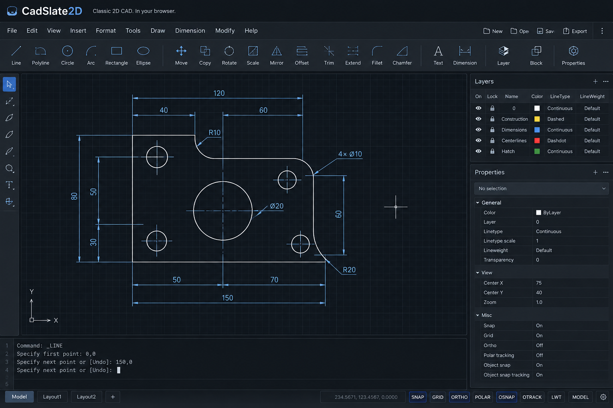

# CadSlate2D

**Classic 2D CAD. In your browser.**

CadSlate2D is a free, browser-native, local-first 2D CAD application inspired by classic command-driven drafting: a command line, keyboard aliases, precise coordinate entry, object snaps, grips, and local files. No installation, no account, no cloud workspace.



> The image above is the visual target, not a screenshot of the current build.

## Status

Milestones **M0 — The Line**, **M1 — Input and Basic Entities**, and **M3 — Robust Modify Geometry** are complete ([M3 review](docs/reviews/m3-exit-review.md)). Everything planned for **M2 — OSNAP, Grips, and Basic Modify** is implemented; that milestone is waiting only for a hands-on assessment by someone with classic CAD experience ([review](docs/reviews/m2-exit-review.md)). **M4 — Drawing Organization** — layers, colours, linetypes, text, blocks — is next. You can draw lines, circles, arcs, rectangles, and polylines with arc segments by command or pointer, snap exactly to existing geometry, draft with ORTHO, POLAR, and a grid, select with clicks and boxes, edit by grips, move, copy, rotate, scale, mirror, stretch, offset, trim, extend, fillet, chamfer, break, join, and erase, undo and redo whole commands, export DXF, and reopen it — all in a static page with no backend. What each modify command does to each kind of object is listed in [`docs/modify-matrix.md`](docs/modify-matrix.md). See the [milestones](https://github.com/LAA-Software-Engineering/cadslate2d/milestones) and [issues](https://github.com/LAA-Software-Engineering/cadslate2d/issues) for what comes next, in implementation order.

## What works today

Type anywhere on the page; you never need to click the command line first. The toolbar and the panels are optional: every button runs the same command you could type — a Layers panel action is `LAYER` with its answers, a change in the Properties panel is `CHPROP`, and the log shows each step — and the `Toolbar`, `Layers`, and `Properties` buttons in the header hide them.

| Command | Aliases | What it does |
| --- | --- | --- |
| `LINE` | `L` | A chain of line segments. Options: `Close`, `Undo`. |
| `CIRCLE` | `C` | Centre and radius, or `Diameter`, `2P`, `3P`. |
| `ARC` | `A` | Three points; or start, `Center`, end; or start, centre, `Angle`. |
| `PLINE` | `PL` | One polyline through a chain of points. `Arc` switches to arc segments that continue smoothly from the one before; `Line` switches back. Also `Close`, `Undo`. |
| `RECTANG` | `REC` | A closed rectangle from two corners. |
| `COLOR` | `COL` | The colour new objects are given: a number from 1 to 255, a name (`red`, `yellow`, `green`, `cyan`, `blue`, `magenta`, `white`), `ByLayer` (the default), or `ByBlock`. An object with a colour of its own keeps it whatever its layer's colour becomes. |
| `LWEIGHT` | `LW` | The lineweight new objects are given: one of the standard widths in millimetres (`0.25`, `0.5`, `1`, … `2.11`), `Default`, `ByLayer` (the default), or `ByBlock`. Lineweights are shown only while `LWT` on the status bar is on. |
| `UNITS` | `UN` | Says what the drawing's numbers are: unitless (the default), millimetres, centimetres, metres, inches, or feet. Nothing is rescaled; the unit is what a typed `25mm` is converted into, and it is saved with the drawing. |
| `LINETYPE` | `LT` | Linetypes from the command line: `Load` one of the built-in patterns (`Dashed`, `Hidden`, `Center`, `Phantom`, `Dot`, `Dashdot`), `Set` the linetype new objects are given (a loaded name, `ByLayer`, or `ByBlock`), `Delete` one nothing uses, and `?` to list. |
| `LTSCALE` | `LTS` | What every linetype pattern is multiplied by. Patterns are defined in drawing units — a `Dashed` dash is 0.5 — so a drawing in millimetres wants a larger scale than one in metres. |
| `TEXT` | `DT` | A single line of text: start point (or `Justify` first: `Left`, `Center`, `Right`), height, rotation, then the text itself — spaces and all; Enter with nothing typed makes no text. Drawn with a stroke font, sharp at every zoom ([ADR-0016](docs/adr/0016-text-rendering.md)). |
| `MTEXT` | `MT`, `T` | A paragraph: two corners give the top left and the width (`Height` sets the text height first), then the words in a small editor — Enter breaks the line, Ctrl+Enter or OK finishes, Escape cancels. Lines wrap at spaces to the width; a word wider than the width stands alone. |
| `TEXTEDIT` | `ED` | Changes what a picked text says; Enter keeps the old text. On a paragraph it reopens the editor with the words. |
| `BLOCK` | `B` | Makes a block out of the selection: a name, a base point, and the objects, which are replaced by one reference to the new block. The objects keep their properties inside the definition; a line on layer `0`, or with a `ByBlock` colour, is drawn as each reference is. A name already taken asks before the block is redefined — and then every reference to it changes ([ADR-0017](docs/adr/0017-blocks.md)). |
| `INSERT` | `I` | Places a block: its name (`?` lists them), the insertion point, a scale factor, and a rotation angle, previewed at the pointer. |
| `EXPLODE` | `X` | Takes the selected objects apart one level: a block reference becomes its definition's objects where the reference put them (nested references stay references), and a polyline its lines and arcs. Other objects are refused by name. |
| `CHPROP` | `CH`, `PROPERTIES` | Changes the layer (`LAyer`), colour, linetype, or lineweight of the selected objects, all of them in one step; several properties in one go, until Enter. |
| `LAYER` | `LA` | Layers from the command line: `New`, `Set` (the layer new objects go on), `Color`, `LWeight`, `LType`, `ON`, `OFF`, `Lock`, `Unlock`, `Rename`, `Delete`, and `?` to list. Names may contain spaces; several can be given at once, separated by commas. Objects on a layer that is off are hidden and cannot be picked; objects on a locked layer cannot be changed. |
| `ERASE` | `E`, Delete | Erases the selected objects. |
| `MOVE` | `M` | Moves the selection from a base point to a second point. |
| `COPY` | `CO`, `CP` | Copies the selection; keeps placing until Enter. |
| `ROTATE` | `RO` | Rotates the selection about a base point, by a typed angle or towards the pointer. |
| `SCALE` | `SC` | Scales the selection uniformly about a base point, by a typed factor or the pointer's distance. |
| `MIRROR` | `MI` | Reflects the selection across a line through two points; asks whether to erase the originals. |
| `OFFSET` | `O` | A parallel copy of a line, a concentric copy of a circle or an arc, or the offset of a polyline, at a set distance on the side you pick — or, with `Through`, through a point you pick. Repeats until Enter. |
| `TRIM` | `TR` | Choose the cutting edges and press Enter — or just Enter to use every object — then pick objects on the part to remove. Lines, arcs, circles, and polylines can be trimmed ([details](docs/modify-matrix.md)). The part a click would remove is shown in red as you hover. |
| `EXTEND` | `EX` | Choose the boundary edges and press Enter — or just Enter for every object — then pick lines, arcs, or open polylines near the end to carry on to the first boundary. The extension is previewed as you hover. |
| `FILLET` | `F` | Joins two lines, arcs, or circles with a tangent arc, trimming or extending them (a circle is left whole). Two picks on one polyline round the corner between them; `Polyline` rounds every corner. `Radius` sets the radius (remembered); zero makes a sharp corner. |
| `CHAMFER` | `CHA` | Joins two lines with a straight bevel. Two picks on one polyline bevel the corner between them; `Polyline` bevels every corner. `Distance` sets the two distances (remembered). |
| `STRETCH` | `S` | Moves what is inside a crossing window and leaves the rest: line and arc ends and polyline vertices inside the window move, so objects reaching into it change shape. A circle moves only if its centre is inside. |
| `BREAK` | `BR` | Removes the part of a line, arc, circle, or polyline between two points. The pick is the first point (`First` names another); `@` as the second breaks the object in two at one point. A circle becomes an arc. |
| `JOIN` | `J` | Makes one object out of several: collinear lines become a line (a gap is bridged), touching arcs of one circle an arc or a circle, and lines, arcs, and open polylines that meet end to end a polyline. `Close` turns the selected arcs into their whole circle. |
| `UNDO` | `U`, Ctrl+Z | Reverts the last command. |
| `REDO` | Ctrl+Y, Ctrl+Shift+Z | Re-applies the last undone command. |
| `OSNAP` | `OS` | Chooses which object snaps run. Each mode is switched by its keyword; Enter finishes. |
| `GRID` | | Sets the grid spacing (10 at start). |
| `POLARANG` | | Sets the angle between polar tracking directions (90° at start). |
| `OPEN` | `DXFIN`, Ctrl+O | Opens an ASCII DXF file. Lines, circles, arcs, polylines — including their arc segments — and text (TEXT and MTEXT, with their styles) are imported with their layers, colours, linetypes, and lineweights, and the tables with them; a paragraph's formatting codes are dropped and reported, its words and line breaks kept. Everything else is counted and reported. |
| `DXFOUT` | `SAVE`, `SAVEAS`, `EXPORT`, Ctrl+S | Downloads the drawing as ASCII DXF (R12), with its layers, linetypes, and text styles. Polyline arc segments are written as bulges; a paragraph is written as one TEXT per line, since R12 has no MTEXT. R12 has no lineweights either: the command log says how many were dropped. |

Whenever a command asks you to pick one object — OFFSET, TRIM, EXTEND, FILLET, CHAMFER, BREAK — the object under the pointer is highlighted before you click.

Modify commands work in either order: select first and then give the command, or give the command and select at `Select objects:`, finishing with Enter.

Options shown in brackets, as in `Specify next point or [Close/Undo]:`, are chosen by their capital letter.

| Input | Meaning |
| --- | --- |
| `100,200` | Absolute point |
| `@500,0` | Point relative to the previous one |
| `@500<45` | Relative polar: distance `<` angle in degrees, counter-clockwise from +X |
| `500` | At a next-point prompt: that distance towards the cursor (direct distance) |
| `25mm`, `2.5m,300mm`, `@1in<45` | A length with a unit — `mm`, `cm`, `m`, `in`, `ft` — converted into the drawing's unit. Needs a drawing unit: see `UNITS` |
| Click | A point while a command asks for one; on a grip, takes the grip; otherwise adds the object under the cursor to the selection (Shift+click removes it) |
| Click or drag on empty space | A selection box: left to right selects what is entirely inside (window); right to left selects what it touches (crossing) |
| Enter / Space | Accept or finish; at the idle prompt, repeat the last command |
| Escape | Cancel the command; pressed again, clear the selection |
| Up / Down | Recall earlier input |
| Wheel / middle-drag | Zoom about the cursor / pan |
| F3 | Object snaps on or off (on at start) |
| F8 | ORTHO on or off: the pointer draws horizontally or vertically from the previous point |
| F10 | POLAR on or off: the pointer locks onto angles at a fixed increment from the previous point |
| F7 | Grid on or off (on at start). Zoomed out, it shows every 2nd, 5th, 10th… line rather than crowding |

### Object snaps

While a command asks for a point, the pointer snaps to nearby geometry. A marker shows the snap that a click would take, and the status bar names it and shows its exact coordinates. Typed coordinates are never snapped.

| Snap | Marker | Lines | Circles | Arcs | Polylines |
| --- | --- | --- | --- | --- | --- |
| Endpoint | square | both ends | — | both ends | every vertex |
| Midpoint | triangle | middle | — | middle of the arc | middle of every segment |
| Center | circle | — | centre | centre | — |
| Quadrant | diamond | — | 0°, 90°, 180°, 270° | those the arc passes | — |
| Intersection | cross | where any two entities meet; polylines segment by segment | | | |
| Nearest | hourglass | the closest point on the entity (off by default) | | | |
| Perpendicular | right-angle sign | the foot of the perpendicular from the point you are drawing from (off by default) | | | |
| Tangent | circle under a bar | — | where a line from the point you are drawing from touches it (off by default) | the same, if on the arc | arc segments |
| Insertion | two squares | the insertion point of a text, which offers no other snap | | | |

The closest snap point within ten pixels wins. Perpendicular and Tangent are constructions from the previous point, so they need one, and they are offered wherever you hover the object — not only at the point itself. Hovering a circle or arc also offers its centre. Nearest applies only when no other snap is in reach. An entity being moved is not offered as a target at its old position. `OSNAP` chooses the running modes; F3 switches them all off and on.

### Grips

Selected objects show grips: small squares you can take hold of. Click a grip (it turns red), then click where it should go — or press, drag, and release. While a grip is in hand you can type coordinates (`@` is relative to where the grip started), use object snaps, ORTHO, and POLAR, press Enter to drop it at the pointer, or Escape to put it back. One grip edit is one undo step, and the object stays selected.

| Object | Grips | Dragging one… |
| --- | --- | --- |
| Line | two endpoints, midpoint | an endpoint stretches the line; the midpoint moves it |
| Circle | centre, four quadrants | the centre moves it; a quadrant sets the radius |
| Arc | two endpoints, midpoint, centre | an endpoint or the midpoint re-fits the arc through the new point, keeping the other two; the centre moves it |
| Polyline | every vertex | moves that vertex |

A position that would collapse the object — a line of no length, a circle of no radius, an arc through three points in a line — is refused. Grips are hidden when more than 100 objects are selected.

### Layers

Every object is on a layer; new objects go on the current one, and an object made from another — a copy, an offset, a piece of a trim — stays on its source's. `LAYER` makes and manages them, and the Layers panel on the right does the same by button: switch on or off, lock, make current, create, rename, delete. It waits while a command is in progress. A layer that is **off** hides its objects from the screen and from the pointer. A layer that is **locked** still shows them, and they can be snapped to and trimmed against, but no command changes them.

Objects are drawn in the colour of their layer (`LAYER`, `Color`), or in a colour of their own if they were drawn after `COLOR` set one. A colour is a number from 1 to 255 or one of seven names: 1 red, 2 yellow, 3 green, 4 cyan, 5 blue, 6 magenta, 7 white. Colour 7, which a new layer has, is the foreground: light on the dark canvas.

The Properties panel shows what is selected — how many objects of which kinds — and the layer, colour, linetype, and lineweight they share, or that they vary; for one object it also lists what defines it, read only. Changing a value there runs `CHPROP` on the selection. The summary is computed in Rust and is a few counts and strings however large the selection.

A layer also has a lineweight (`LAYER`, `LWeight`), and an object can have one of its own (`LWEIGHT`). They are drawn at their true width — 1 mm is about 3.8 pixels — while **LWT** on the status bar is on, and at the ordinary width while it is off. A lineweight never changes how an object is picked or snapped to.

And a layer has a linetype (`LAYER`, `LType`), as an object can (`LINETYPE`). A linetype is a pattern of dashes and gaps in drawing units, multiplied by `LTSCALE`; it runs along an object from its start — through the vertices of a polyline, round its arcs — and stays put as the view zooms. A pattern too fine to see at the current zoom is drawn solid. Dashes are drawn by the shader from where along the object each piece begins, so loading a linetype or changing `LTSCALE` touches no geometry ([ADR-0015](docs/adr/0015-linetype-rendering.md)). Picking and snapping see the whole object, gaps included.

Layers, colours, linetypes, and the settings for new objects are written to DXF and read back from it, from any release. Lineweights are read from newer files but not written — R12 has no place for them — and the export says how many were lost ([ADR-0005](docs/adr/0005-dxf-r12-ascii-baseline.md), amended).

### ORTHO and POLAR

Both constrain the pointer's direction from the previous point, and both show a readout such as `Polar: 50.0000 < 45°` in the status bar. A typed distance then runs exactly along that direction.

- **ORTHO** always constrains to horizontal or vertical.
- **POLAR** locks only while the pointer is within a few pixels of a tracked direction, shows that direction as a line, and lets go when the pointer moves away.
- They are never on together: switching one on switches the other off.

The order of precedence for a point is fixed: **typed coordinates, then an object snap, then ORTHO or POLAR, then the free cursor.**

Unexported changes exist only in the browser tab until autosave arrives (M5); the page asks before you leave with unexported work.

## Architecture in one paragraph

Rust compiled to WebAssembly owns all CAD state — entities, commands, selection, undo history, snapping, DXF — and prepares batched render data. TypeScript owns the React shell and the WebGL2 context and submits those batches to the GPU. The boundary between them is deliberately coarse: browser events go in, dirty flags come out, and frames are pulled in bulk. There is no backend; the production build is a folder of static files.

Details: [`docs/DESIGN.md`](docs/DESIGN.md) (implementation baseline), [`docs/adr/`](docs/adr/README.md) (architecture decisions), [`docs/roadmap.md`](docs/roadmap.md) (what is next and why), and [`docs/reviews/`](docs/reviews/) (milestone reviews with evidence).

## Development

### Prerequisites

| Tool | Version | Install |
| --- | --- | --- |
| Rust | pinned in `rust-toolchain.toml` (installed automatically by rustup) | <https://rustup.rs> |
| `wasm-bindgen-cli` | exactly the `wasm-bindgen` version pinned in `Cargo.toml` | `cargo install wasm-bindgen-cli --version 0.2.129 --locked` |
| Node.js | 22 or newer | <https://nodejs.org> |
| pnpm | 10 or newer | `corepack enable pnpm` |

The `wasm32-unknown-unknown` target, `rustfmt`, and `clippy` come with the pinned toolchain. `wasm-opt` is provided by the `binaryen` dev dependency; nothing to install.

### First run

```bash
pnpm --dir web install
```

```bash
pnpm --dir web dev
```

`dev` builds the WASM core (debug) and starts Vite. After changing Rust code, rebuild with `pnpm --dir web wasm` and reload the page.

### Everyday commands

| Task | Command |
| --- | --- |
| Full check (run before pushing) | `scripts/check.sh` |
| Rust tests | `cargo test --workspace` |
| Geometry regression corpus only | `cargo test -p cad-geometry --test regression` (see [`test-data/geometry/`](test-data/geometry/README.md)) |
| Long stress run of the geometry property tests (not part of the check) | `scripts/stress.sh` |
| Rust lints | `cargo clippy --workspace --all-targets -- -D warnings` |
| Rust format | `cargo fmt --all` |
| Crate-boundary check | `scripts/check-boundaries.sh` |
| Build WASM (debug / release) | `pnpm --dir web wasm` / `pnpm --dir web wasm:release` |
| Web typecheck, lint, unit tests | `pnpm --dir web typecheck` / `lint` / `test` |
| Production bundle | `pnpm --dir web build` → `web/dist/` |
| End-to-end tests (needs a production bundle) | `pnpm --dir web e2e` |
| Rust benchmarks (store, index, scene, snapping, grips, offset) | `cargo bench -p cad-benchmarks` |
| Re-record visual baselines (Chromium) | `E2E_BROWSERS=chromium pnpm --dir web exec playwright test --update-snapshots` |
| Generate a benchmark drawing | `cargo run --release -p cad-benchmarks --bin generate-drawing -- 100000 benches/generated-drawings/lines-100k.dxf` |
| Render-transport measurement in the browser | `pnpm --dir web bench:transport` (after `build` and generating `lines-1k`, `-10k`, `-100k`) |
| Curve-rendering experiment in the browser | `pnpm --dir web bench:curves` (after `build`) |
| Colour-transport experiment in the browser | `pnpm --dir web bench:styles` (after `build`) |
| Linetype experiment in the browser; rewrites the pictures in ADR-0015 | `pnpm --dir web bench:linetypes` (after `build`) |
| Text-rendering experiment in the browser; rewrites the pictures in ADR-0016 | `pnpm --dir web bench:text` (after `build`) |

First-time Playwright setup: `pnpm --dir web exec playwright install chromium firefox`. The suite runs in Chromium and Firefox by default; choose browsers with `E2E_BROWSERS=chromium,firefox,webkit` (WebKit needs `playwright install --with-deps webkit`). CI runs Chromium only, because headless Firefox on the hosted runner provides no WebGL2.

### Deployment

`web/dist/` is fully static. Serve it from any file server or static host, under any base path. There is no server-side component.

### Repository layout

```text
crates/
  cad-core/       points, bounds, entity IDs, tolerances, view math
  cad-geometry/   pure geometric functions
  cad-input/      command-line tokenizer and parser
  cad-text/       the stroke font, its metrics, and the strokes of a string
  cad-document/   drawing, entities, storage, spatial index, transactions
  cad-commands/   Session, command state machines, selection
  cad-dxf/        DXF import/export
  cad-render/     RenderScene and OverlayFrame preparation
  cad-wasm/       the JS/WASM boundary (marshalling only)
web/
  src/cad/        TypeScript wrapper around the WASM package
  src/app/        CadApp, frame loop, UI store, key routing, host services
  src/renderer/   WebGL2 adapter (the only code that touches WebGL)
  src/ui/         React shell and theme tokens
  e2e/            Playwright tests and the plain static server they run against
  bench/          Browser measurements, run on demand
scripts/          build-wasm.sh, check.sh, check-boundaries.sh, stress.sh
test-data/        DXF fixtures, geometry regression cases, screenshots
benches/          cad-benchmarks crate: drawing generator and criterion benchmarks
docs/             DESIGN.md, ADRs, milestone reviews, roadmap
```

## Contributing

Read [`AGENTS.md`](AGENTS.md) first. It holds the architecture rules, engineering principles, testing rules, and workflow that apply to every change, whether written by a person or an AI agent.

## License

Not yet decided. CadSlate2D is free to use; open-source licensing is a separate governance decision (DESIGN §44).
