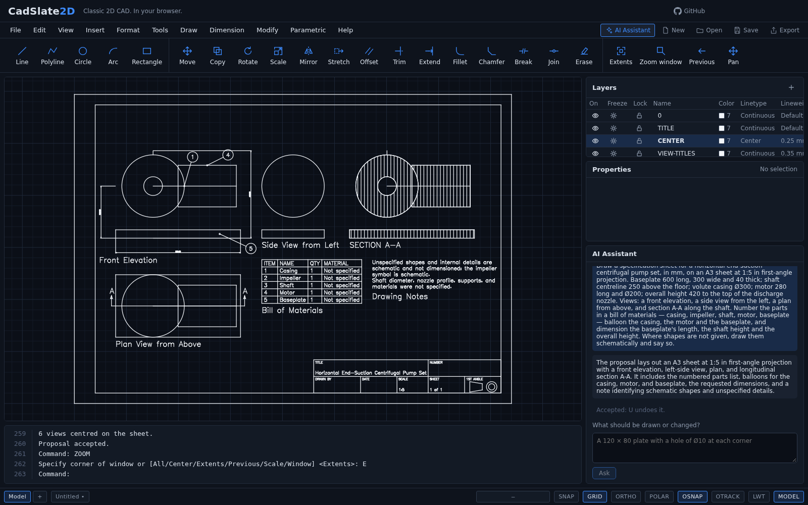

# CadSlate2D

**Classic 2D CAD in your browser. Optionally, describe what to draw.**

CadSlate2D is a free, local-first 2D CAD program in the AutoCAD tradition, running as a static web page: a command line with the classic commands and aliases, object snaps and tracking, grips, layers, blocks, dimensions, hatches, constraints, paper-space layouts, plotting to PDF, and DXF and DWG files. No installation, no account, no cloud: your drawings never leave your browser and the files you choose.

On top of that, an optional AI assistant turns a sentence into a drawing — a part, a floor plan, a section, or a whole engineering sheet with its views, dimensions, bill of materials, and title block — as a proposal you accept or reject. It is the one part that needs an account and a network, and the program is complete without it.

**Try it:** [cadslate2d.com](https://cadslate2d.com). Nothing to install.

## Draw it

Type anywhere on the page. The command line, the menus of the classic workspace, the toolbar, and the panels all run the same commands.

- **Draw** lines, polylines, circles, arcs, ellipses, splines, rectangles, polygons, donuts, construction lines, points, text, multiline text, wide polylines, and revision clouds — by command or pointer, with object snaps, snap tracking, ORTHO, POLAR, grid snap, direct distance entry, and grips.
- **Modify** with the classic set: move, copy, rotate, scale, mirror, stretch, offset, trim, extend, fillet, chamfer, break, join, array, align, explode, lengthen, and more; what each does to each kind of object is in [`docs/modify-matrix.md`](docs/modify-matrix.md).
- **Organise** with layers and layer states, colours, linetypes, lineweights, blocks with attributes, groups, and draw order.
- **Annotate** with text styles, every kind of dimension and dimension chains, leaders and multileaders, hatches with patterns, wipeouts, and tables and notes on a sheet.
- **Constrain** geometry — parallel, perpendicular, tangent, equal, a length, a diameter — and make parts that stay consistent when a parameter changes.
- **Generate** floor plans from a brief, a plan's elevations and sections, a part's orthographic views, staircases, title blocks, and composed sheets.
- **Lay out** sheets with viewports in paper space, and **plot** to PDF.
- **Exchange** DXF (any release in, R2000 out) and DWG (AutoCAD 2000, 2004, 2007/2008, both ways); what every record becomes is in [`docs/dxf-matrix.md`](docs/dxf-matrix.md) and [`docs/dwg-matrix.md`](docs/dwg-matrix.md).
- **Keep** your work: everything is undoable; the drawing is autosaved in the browser and offered back after a crash or a closed tab; nothing is sent anywhere.

Every command, its options, and the keys: [`docs/commands.md`](docs/commands.md).

## Or describe it

The AI assistant is optional — switch it on by signing in from its panel — and when it is on, you say what you want:

> *A round flange centred at 0,0: 150 outside, a 50 bore, and eight Ø12 holes on a 110 pitch circle*

> *A floor plan on a 10 × 25 m plot: 3 bedrooms, one of them a suite with its own bathroom, a kitchen connected to the living room, about 120 m² in all*

> *Draw the standard views of a block 100 wide, 50 high and 40 deep with a 10 mm hole right through it from the front, in first-angle projection*

> *Draw a drawing sheet for an L-bracket on an A4 sheet at 1:1 in third-angle projection, with front, left side and top views … Dimension the width, height and depth. Add a bill of materials and balloon it.*

With objects selected, talk about them — *move these 25 mm up*, *make this plate 20 mm wider without moving the holes relative to the edges*, *put the bathroom next to both bedrooms*, *show me another option*.

What comes back is a **proposal**, drawn on the canvas for you to accept as one undo step, reject, or refine. The model never writes geometry: it answers with operations the program validates, runs as ordinary commands, and reviews — a view with no room, a label over another, text too small to read, all go back to the model to put right before you see the result. A sheet of several views is composed by the program: views placed in projection and aligned, sections marked, parts tabled and ballooned, a detail at its own scale, the whole centred on its paper. Every request above is in the program's test corpus, asked in English and Portuguese, and checked on every build.

More examples, and how it works: [`docs/ai-assistant.md`](docs/ai-assistant.md).

## How it is built

Rust compiled to WebAssembly owns all CAD state — entities, commands, selection, undo, snapping, constraints, file formats — and prepares batched render data. TypeScript owns the React shell and the WebGL2 context. The boundary is coarse: events in, dirty flags out, frames pulled in bulk. The CAD editor needs no backend — its production build is a folder of static files — and the optional AI assistant talks to a separately hosted service. Each crate and module has one reason to change, every behaviour ships with its tests, and every geometry bug fixed becomes a permanent regression case.

| | |
| --- | --- |
| [`docs/DESIGN.md`](docs/DESIGN.md) | The implementation baseline |
| [`docs/adr/`](docs/adr/README.md) | Architecture decisions, with the evidence behind each |
| [`docs/roadmap.md`](docs/roadmap.md) | What was done, milestone by milestone, and what is next |
| [`docs/reviews/`](docs/reviews/) | Each milestone's exit review |
| [`docs/development.md`](docs/development.md) | Building, testing, and running it locally |
| [`AGENTS.md`](AGENTS.md) | The rules every change follows, by a person or an agent |

## Status

Version 0.2.12. Milestones M0 to M25 are complete: the classic drafting set, DXF and DWG, layouts and plotting, the AI assistant with its five levels of requests — drafting, parts and constraints, floor plans, views and sections, composed sheets. What remains needs a person: a check on real GPUs and in WebKit, and of the files in AutoCAD and a desktop PDF viewer ([M15](https://github.com/cadslate2d/cadslate2d/milestone/16)). See the [milestones](https://github.com/cadslate2d/cadslate2d/milestones) and [issues](https://github.com/cadslate2d/cadslate2d/issues).

## Contributing

Start from an issue, run `make check`, ship tests with the change, and sign the [CLA](CLA.md) on your first pull request: [`CONTRIBUTING.md`](CONTRIBUTING.md). Report vulnerabilities privately: [`SECURITY.md`](SECURITY.md). The project keeps a short [code of conduct](CODE_OF_CONDUCT.md).

## License

CadSlate2D is free software under the **GNU Affero General Public License, version 3 or later** ([`LICENSE`](LICENSE); [ADR-0035](docs/adr/0035-licence.md)). You may use, study, change, and share it; if you serve a modified version to others over a network, you must offer them its source. The name and the logo are not part of the licence: a modified version needs a name of its own ([`TRADEMARKS.md`](TRADEMARKS.md)). What the build contains from others is in [`docs/provenance.md`](docs/provenance.md). The hosted AI service is a separate work, kept in a private repository.
