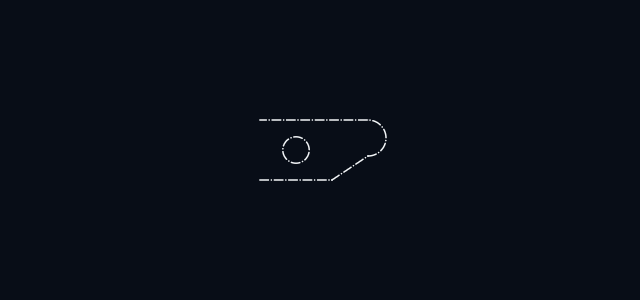
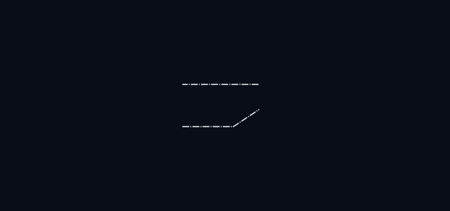
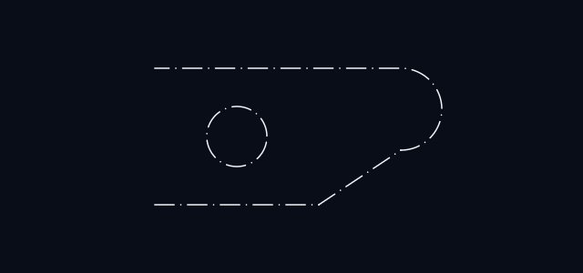
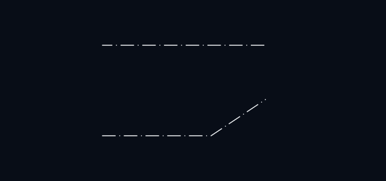
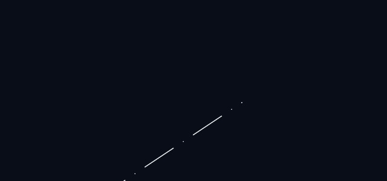

# ADR-0015: Linetype rendering — dashes drawn by the shader from a distance along the path

**Status:** Accepted (2026-10-05)  
**Date:** 2026-10-05  
**Kind:** Evidence (resolves the choice DESIGN §23.2 and ADR-0003 left open)  
**Design refs:** §12.2–12.4, §23.1, §23.2, §32, §46

## Context

DESIGN §23.2 asks two things of a linetype: it must "remain stable across entity segments and zoom", and "render data should carry accumulated path distance where required". ADR-0003 noted that dash patterns would need that distance per segment and left room for it without deciding how dashes are drawn.

The requirements, spelled out:

- a pattern is a sequence of dash and gap lengths in **drawing units**, times a global scale;
- along a polyline the pattern **carries on through the vertices**, and along an arc it runs by **arc length** (ADR-0009 draws arcs as arcs);
- zooming and panning change nothing about where the dashes are in the drawing, and upload nothing (ADR-0003);
- committed geometry still crosses the boundary in a few whole buffers (ADR-0002).

## The candidates

**Shader.** A dashed segment is one instance, exactly as a continuous one is, plus one number: the distance along its path at which it starts. The fragment shader adds how far along the segment the pixel is, finds where that falls in the pattern, and shades it or not.

**Split.** When the scene is built, every dashed segment is cut into its dashes, and each dash is an ordinary instance of a continuous line.

## Evidence

`web/src/renderer/webgl/linetype-probe.ts` draws the same generated paths both ways in its own WebGL2 context (`pnpm --dir web bench:linetypes`, after a build). The paths are polylines of four segments, 40 to 80 units each, with a dashed pattern of 6 on, 3 off — about seven dashes per segment. Measured in headless Chromium with software WebGL, the only renderer available here, so frame times are a rasteriser's; what the two candidates cost *relative to each other* is the finding.

100,000 dashed segments on a 1024 × 1024 canvas:

| | Shader | Split | Split ÷ shader |
| --- | --- | --- | --- |
| Instances | 100,000 | 728,717 | 7.3 |
| Bytes of instance data | 2.0 MB | 11.7 MB | 5.8 |
| Building the instance data | 1.6 ms | 37.6 ms | 24 |
| Frame at 0.25 px per unit | 2.39 s | 15.25 s | 6.4 |
| Frame at 1 px per unit | 1.17 s | 6.40 s | 5.5 |
| Frame at 4 px per unit | 0.69 s | 4.39 s | 6.3 |

At 10,000 segments the ratios are the same: 72,960 instances against 10,000, and frames 5.6 to 6.6 times slower.

What the measurement establishes:

- **Split multiplies everything by the number of dashes per segment**, and that number is not bounded by anything the program controls: it is the length of a line over the length of a pattern. A long line with a fine pattern, or a small global scale, is thousands of instances from one entity.
- **The shader candidate costs what a continuous line costs**, plus four bytes per instance and a short loop per fragment.
- **Split rebuilds and re-uploads the whole scene when the global scale changes**; for the shader it is a uniform.

The same small scene drawn both ways — a path of two lines, a half circle, and a third line, with one dash-dot pattern running along all of it, and a circle:

| Zoom | Shader | Split (lines only) |
| --- | --- | --- |
| 0.6 |  |  |
| 1.5 |  |  |
| 4 |  |  |

In the shader's pictures the pattern passes the corner between the two lines without restarting, continues round the half circle by arc length, and comes out onto the last line in step; the circle carries the pattern on its own. On the lines, the dashes of the two candidates fall in the same places, as they must: both put them at the same distances along the path. The split candidate's arcs are not drawn: they would be cut into shorter arcs by the same rule, at the same cost in instances.

Not established: frame time on a real GPU. A fragment shader with a loop is exactly the kind of thing whose cost differs between a software rasteriser and hardware; the ratio of instance counts does not.

## Decision

### 1. Dashes are drawn by the fragment shader

Each committed instance gains the **distance along its entity's path at its first end**, in drawing units, as one `f32` in a buffer of its own — beside the geometry and the style indices, which keep their layouts (ADR-0008, ADR-0014). An arc instance needs to say which way its path runs round it as well, since arcs are stored counter-clockwise and a polyline may go round one clockwise: two numbers for an arc.

For a line, a circle, or an arc on its own the distance starts at zero. For a polyline it accumulates through the vertices, by chord for straight segments and by arc length for arc segments.

### 2. A pattern is dash and gap lengths in drawing units

A pattern is up to eight lengths, alternately dash and gap, and repeats. A dash of length zero is a dot. Patterns are few and small; they reach the shader as a small table, already multiplied by the global scale, and a style row (ADR-0014) names the one an instance is drawn with. Continuous is "no pattern", and costs a continuous line nothing but the test.

Changing the global scale or a pattern changes that table and no geometry.

### 3. Each dash is a capsule

The shader takes the distance from the pixel to the nearest dash, along the line, together with the distance across it, as the distance to a capsule: dashes have round ends like the lines themselves, a zero-length dash is a round dot of the line's width, and the edges are antialiased the same way as everything else.

### 4. Too fine to see is drawn solid

When a whole period of the pattern is under four pixels on screen, the dashes cannot be told apart and would shimmer as the view moves. The line is drawn continuous instead. This is the one place where what is drawn depends on the zoom, and it changes the appearance only where there was nothing to see.

### 5. The overlay stays continuous

Previews, highlights, and the rest of the overlay have no path distances and are drawn solid, as now. A dashed line is picked and snapped to along its whole length, gaps included: the geometry is the line.

## Alternatives considered

- **Split on the CPU.** Rejected: see the evidence. It is the only candidate that needs no shader work, and the only one whose cost the user's data can make unbounded.
- **Split in the vertex shader**, drawing a fixed number of quads per instance. Rejected: the number of dashes on a segment is not fixed, so it would cap it or waste the rest.
- **A one-dimensional texture as the pattern**, sampled by distance. Considered: no loop in the shader. Not chosen because scaling a texture blurs dash ends that should be round caps of the line's width, and dots would need a special case; the loop is at most four iterations.
- **Distance in screen space**, so that dashes are a fixed size in pixels. Rejected: the pattern would slide along the line as the view zooms, which is what §23.2 rules out.

## Consequences

- Every committed instance grows by four bytes, dashed or not, and the committed scene by one buffer per kind of primitive.
- Linetypes are a table like layers (ADR-0013), and the style row gains the index of one.
- The arc shader and the stroke shader share the pattern logic, as they share the style lookup.
- Zooming a dashed drawing is a redraw: nothing is rebuilt or uploaded.
- The experiment's shaders are the starting point for the real ones, and stay runnable with the probe.

## Revisit when

- Rendering is measured on a real GPU, and the fragment loop turns out to matter.
- Complex linetypes — with text or shapes in them — are wanted: they are not dashes, and need another mechanism.
