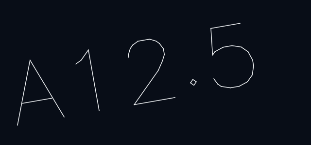
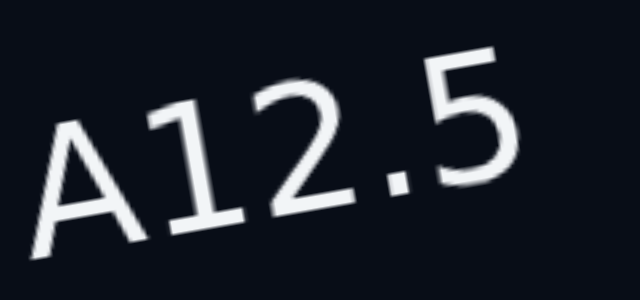
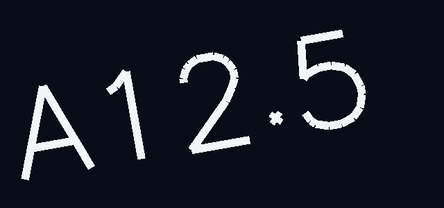

# ADR-0016: Text rendering — a stroke font drawn through the line instances

**Status:** Accepted (2026-10-06)  
**Date:** 2026-10-06  
**Kind:** Evidence (resolves DESIGN §23.5, PROVISIONAL)  
**Design refs:** §12.2–12.4, §23.1, §23.5, §34, §42, §46

## Context

DESIGN §23.5 makes text a separate rendering subsystem and leaves the approach open: it sketches font resolution → glyph metrics → an atlas or signed-distance field → GPU quads, and marks all of it PROVISIONAL. Two constraints narrow the choice before any text is drawn:

- the **document needs text metrics without a browser**: the bounds of a text entity, picking it, headless tests of `TEXT`, and the import of a DXF with text in it all run in `cad-document` and `cad-commands` on the host, under plain `cargo test`;
- **M6's dimensions cannot start until metrics are reliable** (§34): a dimension's layout engine places text by its measured width, and it must get the same answer in Rust as the renderer draws.

And the product constraints hold: no network at run time, so whatever font is used ships with the build; and the bundle stays small.

## The candidates

**Stroke.** A stroke font: every glyph is a few polylines. A text is those polylines laid along its baseline, and each of their segments is an ordinary line instance drawn by the stroke shader every line already uses. This is what classic drafting programs do with their default `txt.shx`.

**Atlas.** The glyphs of an outline font rasterised once into a texture — plain, or as a signed-distance field — and every glyph of every text one textured quad. Metrics would come from the same font's tables, read in Rust.

**Fill.** The glyphs' outlines tessellated into triangles, filled on the GPU. Exact at every zoom; metrics from the same font.

## Evidence

`web/src/renderer/webgl/text-probe.ts` draws the same generated texts all three ways in its own WebGL2 context (`pnpm --dir web bench:text`, after a build). The texts are eight random characters each, ten units tall, scattered at random angles over a 4000-unit square. The stroke candidate uses the Hershey Simplex font the `cad-text` crate ships. The atlas candidate rasterises a sans-serif through Canvas 2D at 48 px per em — a stand-in for a bundled TrueType rasterised in Rust, which costs the same to draw. The fill candidate stands in for tessellated outlines with the stroke font's segments as thin quads, two triangles each; a real outline font has two to four times as many triangles per glyph, so its numbers are a lower bound. Measured in headless Chromium with software WebGL, the only renderer available here, so frame times are a rasteriser's; what the candidates cost *relative to each other*, and how they look, is the finding.

10,000 texts (80,000 characters) on a 1024 × 1024 canvas:

| | Stroke | Atlas | Fill |
| --- | --- | --- | --- |
| GPU instances | 729,203 segments | 80,000 quads | 1,458,406 triangles |
| Bytes of instance data | 11.7 MB | 3.8 MB | 35.0 MB |
| Building the instance data | 40 ms | 8 ms | 137 ms |
| Frame at 0.25 px per unit | 13.5 s | 1.7 s | 0.19 s |
| Frame at 1 px per unit | 5.8 s | 0.97 s | 0.13 s |
| Frame at 4 px per unit | 4.5 s | 0.51 s | 0.09 s |

100,000 texts (800,000 characters), one frame at 1 px per unit:

| | Stroke | Atlas | Fill |
| --- | --- | --- | --- |
| GPU instances | 7,300,945 | 800,000 | 14,601,890 |
| Bytes of instance data | 117 MB | 38 MB | 350 MB |
| Building the instance data | 470 ms | 72 ms | 860 ms |
| Frame | 57 s | 8.8 s | 1.3 s |

So a character of Simplex is about nine segments, and a drawing with ten thousand texts carries about as many committed line instances as a drawing with 730,000 lines. In the software rasteriser the stroke frame is six times the atlas frame; the fill frame, triangles with no antialiasing and no per-pixel work, is far cheaper than either — a property of the rasteriser as much as of the candidate, since on a GPU instances are cheap and pixels are what cost.

The pictures (`docs/adr/images/0016-{stroke,atlas,fill}-zoom-{0.5,2,8}.png`): one text, sixteen units tall, turned ten degrees, at 8, 32, and 128 pixels tall.

  

- The **stroke** text is one line wide at every zoom and sharp at every angle — the look of a drawing, not of a document.
- The **atlas** text is sharp near the size it was rasterised at and blurs as it grows; a signed-distance field would hold its edges at the cost of rounding its corners, and still has to be generated from an outline font.
- The **fill** text is exact, and its stems scale with the zoom: thin to the point of vanishing when small (top right of the stitched pictures), and heavy when large. Without multisampling its edges are jagged.

What each needs to ship:

| | Stroke | Atlas | Fill |
| --- | --- | --- | --- |
| Metrics on the host | arithmetic over the glyph table, in `cad-text` | a TrueType parser in Rust (`ttf-parser`) | the same |
| Font data in the bundle | 3.5 KB (`futural.jhf`) | an open TrueType face: 100–300 KB | the same |
| Rust code | the parser and layout in `cad-text`: 200 lines | the parser, a rasteriser (`ab_glyph`/`fontdue`, or Canvas 2D in the browser — but then two sources of metrics), atlas packing | the parser and a tessellator (`lyon`) |
| Renderer | nothing: text is line instances | a texture, a quad pipeline, a second kind of committed instance | a triangle pipeline, antialiasing |
| Licence | Hershey: free for any use with an acknowledgement (`crates/cad-text/fonts/LICENSE.md`) | SIL OFL, typically | the same |

## Decision

### 1. Text is drawn with a stroke font, as line instances

A text entity's geometry is the strokes of its string: the glyphs of the font laid along the baseline from the insertion point, at the text's height and angle. Those strokes are what the scene builds instances from, through the same `PackedFrame` as every line, so a text is drawn in its layer's colour and its own, highlighted when selected, hidden with its layer, and sharp at every zoom and angle, with nothing added to the renderer.

### 2. The font is Hershey Simplex, shipped in `cad-text`

`cad-text` is a new crate under `cad-document` (ADR-0001 amended) holding the font's glyph table — the Hershey Simplex `.jhf` file, 3.5 KB, parsed on first use — and the two things every layer above needs: the width of a string, and its strokes at a height and angle. Both are plain functions over the table, tested on the host. The font covers printable ASCII; a character it lacks is drawn as a box the width of a digit, so a string is never shorter than it is, and the gap shows.

### 3. The cost is accepted, and bounded

A character is about nine segments. That is the price of drawing text with the renderer there is, and for drawings of hundreds or a few thousand texts — the drawings this is for — it is a small part of the committed scene. At ten thousand texts it is comparable to the "100k entities — usable" target of DESIGN §42 by itself, and at a hundred thousand it is too much: that is the point at which an atlas, with one instance per glyph, earns its texture and its second pipeline. The probe stays runnable, and the metrics layer does not change if the drawing does.

## Alternatives considered

- **A glyph atlas**, plain or signed-distance, as §23.5 sketched. Nine times fewer instances than the stroke font, and the only candidate whose frame time in the rasteriser is close to the fill's. Rejected for now: it needs a TrueType font in the bundle and a parser and rasteriser in Rust to keep one source of metrics, a texture and a second committed pipeline in the renderer, and either it blurs when zoomed in or it is a signed-distance field with its own generation step and its rounded corners. Nothing in M4–M6 needs any of that; §42's 100k-entity target is where it would.
- **Tessellated outlines.** Exact, and the cheapest frame in the software rasteriser, but twice the instance count of the strokes as triangles, five times the bytes, a tessellator in the WASM binary, and antialiasing to solve; and filled text whose stems scale with the zoom is the look of a document, not of a drawing.
- **Canvas 2D or DOM text over the canvas.** Rejected without measurement: metrics would exist only in the browser, which the first constraint rules out, and text would not be part of the scene — not snapped to, not highlighted, not in the same pixels as the lines it labels.

## Consequences

- `cad-text` joins the crate layering: `cad-document → cad-text → cad-core`. The entity's bounds and picking, the DXF reader's import of text, and the dimension layout engine (M6) all measure text through it.
- A text entity (#143) is pure geometry plus a string, height, angle, and insertion point, like every other entity (ADR-0013); its primitives are the strokes' segments.
- The renderer does not know text exists. The scene's instance count grows by about nine per character.
- Only printable ASCII has glyphs. Extending the font — accents, Greek, symbols — is adding lines to a table, not a new mechanism; the Hershey collection has them.
- The experiment stays runnable (`pnpm --dir web bench:text`) and rewrites its pictures.

## Revisit when

- Rendering is measured on a real GPU and a drawing of ten thousand texts does not hold its frame time.
- Dimensions (M6) want a text that scales its stroke weight with its height, or a filled look.
- Text in a language the font does not cover is needed: extend the table first; if the table cannot hold it, the atlas is the next step.
