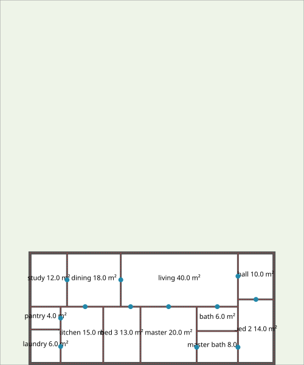

# ADR-0039: Floor plans are laid out by a deterministic search over slicing trees, in a pure crate of their own, `cad-layout`

**Status:** Accepted, provisionally (2026-10-26, by the maintainer). The review's conditions are met by this revision:
- multi-start reliability measured per brief;
- lexicographic ranking;
- refusals that tell impossibility from search failure;
- an explicit circulation contract;
- an adversarial verifier;
- a narrower claim of determinism.

The solver is production-ready only once the M22 exit review confirms these.  
**Date:** 2026-10-25, revised 2026-10-26  
**Kind:** Evidence (a new subsystem and crate; amends ADR-0001's dependency graph)  
**Design refs:** §3, §4, §21, §43–§46; ADR-0001, ADR-0020, ADR-0037, ADR-0038

## Context

M22 (#276) asks for the first domain generator. Its input is a terrain, rooms with target areas and adjacencies, and 25 cm exterior and 15 cm interior walls. Its output is clean, editable walls, doors, labels, and areas. It should work as a `FLOORPLAN` command without AI. Through the AI, the brief comes from plain language and revisions ("make the kitchen bigger") become changes to the brief.

The problem is **layout synthesis**, not drawing. Rooms must be placed so that:
- none overlap;
- all lie inside the buildable area;
- each keeps its area, its minimum width, and its proportions;
- the rooms asked to open onto each other share a wall long enough for a door;
- every room can be reached from the entrance.

The drawing that follows from a layout — wall faces, junctions, doors, labels — is #279 and #280. This ADR decides the brief, the solving method, and where the code lives (#277). The issue asks for a prototype's success rate and time on a corpus of 30 briefs; the prototype is the crate this ADR proposes.

DESIGN §4 rules out BIM: walls stay plain geometry on layers, never wall objects.

## The prototype, and what it measured

`crates/cad-layout` has three parts:
- the brief (`Spec`);
- the search: `solve`, `alternatives`, and `alternatives_within` for a budget of one's own;
- `verify`: an independent check of a plan against its brief.

**The corpus** is `test-data/layout/briefs.jsonl`: 32 briefs, from a studio to a 24-room floor. Each says what should come of it:
- **feasible** (24): a plan is made, and `verify` passes it. They include narrow, shallow, and set-back lots, strict minimum widths and aspect ratios, a chain of rooms in a row, and Portuguese room names.
- **hard** (1): a hall that must open onto five rooms and the street within an aspect ratio of 2.5. Only one arrangement allows it. Either outcome is accepted, a verified plan or an exhausted search, but never an invalid plan or a claim that no plan exists.
- **infeasible** (6): refused before any search, with the reason the brief expects:
  - too much floor for the land;
  - setbacks that leave nothing;
  - a 2 m² bath that must be 1.6 m wide both ways;
  - a 2.5 m² wc with too little wall for its six doors;
  - a 6 m hall on a 6 m lot;
  - twelve rooms whose floor fits the land but not with a wall round each.
- **exhausted** (1): 24 rooms that pass every bound checkable before a search, and that no search lays out.

The corpus test, `crates/cad-layout/tests/briefs.rs`, holds every brief to its expectation in `make check`.

### Reliability from 100 starting seeds

`cargo run --release -p cad-layout --example reliability` solves every brief from 100 starting seeds, far apart: seed s·1,000,003 for s = 0…99. Each `solve` is the whole procedure, every search of its budget. A run is *as expected* when it makes a plan that `verify` passes, or the expected refusal. Times are native, release, x86-64, on the development machine (2026-10-26).

| Brief | Rooms | Expected | As expected | p50 ms | p90 ms | max ms | With circulation | Largest circulation |
| --- | --- | --- | --- | --- | --- | --- | --- | --- |
| studio | 2 | feasible | 100/100 | 18.2 | 18.6 | 21.1 | 100 | 12% |
| one-bed | 4 | feasible | 100/100 | 5.6 | 5.8 | 10.9 | 0 | — |
| two-bed | 6 | feasible | 100/100 | 36.0 | 85.9 | 196.8 | 0 | — |
| three-bed | 9 | feasible | 100/100 | 57.3 | 141.1 | 278.3 | 1 | 4% |
| office | 8 | feasible | 100/100 | 21.9 | 23.3 | 63.7 | 0 | — |
| clinic | 6 | feasible | 100/100 | 12.5 | 23.6 | 28.3 | 0 | — |
| shop | 3 | feasible | 100/100 | 35.9 | 37.5 | 42.7 | 100 | 8% |
| narrow-lot | 4 | feasible | 100/100 | 5.1 | 5.5 | 5.7 | 0 | — |
| shallow-lot | 5 | feasible | 100/100 | 8.3 | 8.9 | 11.1 | 0 | — |
| setbacks | 5 | feasible | 100/100 | 8.0 | 8.4 | 16.1 | 0 | — |
| tight-eight | 8 | feasible | 100/100 | 21.1 | 22.3 | 23.7 | 0 | — |
| villa | 12 | feasible | 100/100 | 52.5 | 110.4 | 213.1 | 0 | — |
| daylight | 5 | feasible | 100/100 | 8.0 | 8.3 | 8.6 | 0 | — |
| **hall-star** | 6 | **hard** | **71/100** | 347.9 | 506.5 | 514.8 | 71 | 13% |
| hall-corridor | 6 | feasible | 100/100 | 25.1 | 72.1 | 191.7 | 1 | 6% |
| chain | 5 | feasible | 100/100 | 8.1 | 8.7 | 15.6 | 0 | — |
| single | 1 | feasible | 100/100 | 1.2 | 1.3 | 1.5 | 0 | — |
| pair | 2 | feasible | 100/100 | 1.6 | 1.8 | 2.2 | 0 | — |
| school-wing | 16 | feasible | 100/100 | 94.5 | 99.9 | 200.1 | 0 | — |
| office-floor | 20 | feasible | 100/100 | 157.4 | 166.5 | 317.7 | 0 | — |
| wide-rooms | 4 | feasible | 100/100 | 61.2 | 66.1 | 74.3 | 100 | 13% |
| square-rooms | 4 | feasible | 100/100 | 5.6 | 5.8 | 6.2 | 0 | — |
| garage | 6 | feasible | 100/100 | 11.7 | 12.3 | 22.3 | 0 | — |
| six-equal | 6 | feasible | 100/100 | 11.8 | 12.2 | 14.4 | 0 | — |
| casa | 6 | feasible | 100/100 | 11.8 | 12.3 | 12.6 | 0 | — |
| too-big | 2 | infeasible | 100/100 | 0.0 | 0.0 | 0.0 | — | — |
| no-land | 1 | infeasible | 100/100 | 0.0 | 0.0 | 0.0 | — | — |
| tiny-wide | 2 | infeasible | 100/100 | 0.0 | 0.0 | 0.0 | — | — |
| crowded-wc | 6 | infeasible | 100/100 | 0.0 | 0.0 | 0.0 | — | — |
| too-narrow-lot | 2 | infeasible | 100/100 | 0.0 | 0.0 | 0.0 | — | — |
| walls-overflow | 12 | infeasible | 100/100 | 0.0 | 0.0 | 0.0 | — | — |
| crowded-24 | 24 | exhausted | 100/100 | 2,442 | 2,488 | 2,511 | — | — |

**Altogether:** 3,171 of 3,200 runs as expected. Every miss is the hard brief's. Across all runs, p50 is 11.4 ms, p90 142 ms, and p99 2.46 s, the exhausted 24-room brief.

**Without circulation** (`CIRCULATION=0`): every feasible brief but four is made 100 times in 100, as with it. The four are studio, shop, wide-rooms, and the hard hall, each 0/100. A slicing must fill its rectangle, so a 25 m² living room beside a 4 m² bath cannot keep both rooms' shapes without a space between them.

### How the measurements changed the method

The first version (proposed 2026-10-25) reported 30/30 from one starting seed per brief, with four searches each. Running it from 100 starting seeds, as the review asked, showed this was not yet evidence of reliability:
- two-bed was 86/100, three-bed 97/100, and the hard hall 51/100;
- circulation appeared in plans that did not need it: 71 of 100 one-bedroom plans.

Measured on the hardest briefs, single searches from 100 seeds each, these changed:

| Change | Effect |
| --- | --- |
| The annealing's penalty per hard violation 100 → **3** | Single-search success: two-bed 19% → 50%, three-bed 46% → 73%. A gentler slope lets the search cross infeasible plans. The ranking does not depend on the weight (§4). |
| **1,500 steps per room** instead of 3,000, and more searches | Shorter searches find a plan more often per millisecond: two-bed 1.5 → 2.6% per ms. |
| **A budget in steps:** 40 searches up to six rooms, fewer above, at least 8 | An exhausted 24-room search takes 2.5 s rather than 10 s. Large briefs, whose single searches succeed 97–100% of the time, need few searches. |
| **Rooms alone first:** the first quarter of the searches make no circulation | Circulation appears only where the rooms alone gave no plan: in 4 briefs, not 15. |
| **A tighter proof** of overflow: (√floor + wall)² per room | The twelve-room overflow is now refused in microseconds as infeasible, not after 2 s as exhausted. |

Two more ideas were measured and dropped:
- **Hotter or colder starts** (T₀ 2 or 50 instead of 10) did no better.
- **Letting each room's area move within its ±5% as a variable of the search** made no difference.

*Each room's floor (white) inside its walls (dark), its centreline rectangle dashed, and a dot on each wall that takes a door. The building sits at the front setback, centred.*

## Decision

### 1. The brief

One JSON shape (`cad_layout::Spec`), in metres, for a spec file, for `FLOORPLAN`'s prompts, and for the intent IR:

| Field | Meaning | Default |
| --- | --- | --- |
| `terrain` | `width` (along the front, x) and `depth` (y) of a rectangular plot; the front lies along the x axis from the origin | — |
| `setbacks` | `front`, `back`, `left`, `right` | 0 |
| `rooms` | `name`, `area` (the floor inside the walls), `min_width`, `max_aspect`, `exterior` (wants an outside wall), `entrance` (the way in) | `min_width` 1.5 m, `max_aspect` 2.5, the first room the entrance |
| `adjacent` | pairs of room names that must share a wall with a door | none |
| `exterior_wall`, `interior_wall` | thicknesses | 0.25 m, 0.15 m |
| `door` | clear width of a door | 0.9 m |
| `max_circulation` | the most floor the search may add as circulation, as a share of the rooms' floor; **0 forbids it** | 0.15 |
| `seed` | the search's first seed | 0 |

The brief is checked before any search (`Spec::check`): sizes positive, names unique and known, a circulation share between 0 and 1, at most 24 rooms.

### 2. The geometry

- **The building is one rectangle,** its outline the exterior walls' centreline. It sits on the front setback, centred along it, and its width is a variable of the search.
- **The rooms tile the outline** as a slicing: cut it across or along, then cut each part again, until each part is a room.
- **Areas are measured inside the walls.** A room's floor is its centreline rectangle less half the thickness of the wall on each side: exterior or interior, by whether that side lies on the outline. A room's area is its floor's.
- **Sizes follow from the slicing.** Each cut divides its rectangle in proportion to the gross areas on either side. The gross areas are corrected for the walls six times, a fixed point, so each floor meets its target. Within the hard ±5% they are usually exact.
- **A door needs** its width, 0.15 m clear of each end, and the thickness of the wall crossing at each end: 1.45 m of shared centreline at the defaults.
- **The entrance's door** needs one side of the entrance room on the outline at least that long.

### 3. The constraints

**Hard**, each checked by the search with what it costs to break, and again by `verify`:
1. inside the buildable area;
2. every room's floor within **±5%** of its area;
3. every room's narrower side at least its minimum width;
4. its aspect at most its maximum;
5. each `adjacent` pair sharing a wall long enough for a door;
6. the entrance having one outside side long enough for one;
7. every room reached from the entrance through doors on walls long enough for one;
8. the circulation space, when there is one, at least a door wide and within the brief's budget.

The rooms do not overlap and leave no gap by construction: a slicing tiles its rectangle. `verify` checks those too.

**Soft**, as the discussion put them:

> E = w_a·E_area + w_r·E_ratio + w_c·E_connectivity + w_p·E_preferences, plus the circulation's cost

| Term | What it measures | Weight |
| --- | --- | --- |
| E_area | Σ relative area error | 10 |
| E_ratio | Σ ln(aspect): squarer is better | 1 |
| E_connectivity | mean number of doors from the entrance | 0.5 |
| E_preferences | rooms that want an outside wall and have none long enough for a window | 2 |
| circulation | its floor over the rooms' floor | 5 |

**The doors** are the `adjacent` pairs, then a breadth-first spanning tree from the entrance over the walls long enough for a door; the asked-for walls come first. They become openings in #280.

### 4. Ranking is lexicographic

What wins is decided without weights:
1. **A plan is a plan only if it keeps every hard constraint.** Only those are returned.
2. **Among plans, those without circulation come first,** then those with it.
3. **Then by soft energy,** lowest first.

Within one search, the best state kept is the lowest in (total hard violation, soft energy), compared in that order. The nearest attempt that an exhausted refusal explains is chosen the same way.

The annealing itself descends a single energy, 3 × hard violation + soft. That weight shapes the search's path, not its result. A finite weight could let an infeasible state outscore a feasible one in the walk, but never in what is kept or returned.

### 5. The search

- **A slicing is a normalised Polish expression** (Wong and Liu, 1986): room operands and V/H cuts in postfix, never the same cut twice in a row. Every slicing has exactly one.
- **Simulated annealing** moves through them:
  - two neighbouring rooms swapped (M1), or any two;
  - a chain of cuts complemented (M2);
  - a room and a cut swapped where the result stays normalised (M3);
  - the outline made wider or narrower;
  - the circulation space made, grown, shrunk, or taken away, when allowed.
- **1,500 steps per room,** the temperature falling geometrically from 10 to 0.005.
- **Multi-start.** `solve` and `alternatives(n)` run searches from the brief's seed and the ones after it, stopping once n distinct plans are found or the budget is spent.
  - **The budget per plan:** 40 searches up to six rooms, then 360,000 steps' worth, at least 8 (`searches_for`).
  - **The first quarter** of the searches make no circulation space.
  - Plans are distinct when any room differs by a centimetre or more.

### 6. The circulation space

It is the contract the review asked for:
- **It appears only when needed:** when the rooms alone gave too few plans in the first quarter of the budget, and only within `max_circulation` of the rooms' floor. Its default is 15%, and the largest the corpus produced is 13%.
- **`max_circulation: 0` forbids it.** A brief that then has no plan is refused as exhausted.
- **It is reported, never hidden.** `Layout::circulation` names it: a space called `circulation`, at least a door wide, which takes doors like a room. It has no area target, and the drawing labels it.

### 7. Refusals tell what happened

`Refusal` has three cases, and a plan is the fourth outcome:

| Outcome | Meaning | Example |
| --- | --- | --- |
| `Ok(Layout)` | A plan that keeps every hard constraint | — |
| `Refusal::Invalid` | The brief cannot be read | "Two rooms are called a." |
| `Refusal::Infeasible` | **No plan exists:** a necessary condition fails, proved before any search | "The bath's 2 m² cannot be 1.6 m wide both ways." |
| `Refusal::Exhausted` | **None was found in the budget,** though one may exist: the constraints the nearest attempt broke, and how many searches were made | "No plan was found in 40 searches, though one may exist; the nearest broke these: The hall could not be kept within its aspect ratio of 2.5." |

The **necessary conditions** behind `Infeasible` are proofs. Each allows the ±5% a room's area may be off and the most wall a room can have:
1. The setbacks leave room inside the exterior walls.
2. Σ 0.95·area fits inside the exterior walls of the buildable area.
3. Σ (√(0.95·area) + the thinner wall)² fits in the largest outline: a room's rectangle is its floor and at least half the thinner wall on each side.
4. Each room's 1.05·area is at least its minimum width squared.
5. Each room's minimum width fits across the buildable area inside the walls.
6. Each room's 0.95·area fits on the buildable area within its aspect ratio.
7. Each room's longest possible perimeter holds a door's wall for each of its doors and the entrance's.

A unit test holds each condition at its bound: a brief a millionth inside it is not refused by it, and one a millionth past it is. The AI and `FLOORPLAN` say a refusal as it is: "this cannot be built because…" only for `Infeasible`, and "no plan was found…" for `Exhausted`.

### 8. The verifier is independent and adversarial

`verify` shares no geometry with the search. It works out every floor, contact, and outside side again from the centreline rectangles, and checks that the floors the plan reports match the walls. Hand-made plans in its tests break it on purpose:
- a door at a T-junction exactly 1.45 m long, and 1 µm short;
- a door through a corner;
- a door to a space that does not exist;
- areas at 4.9% and 5.1% either side;
- a floor that forgets an exterior wall, or every wall;
- an overlap, a gap, and a setback crossed, each by a millimetre;
- a minimum width at the bound and a millimetre past it, and an aspect just past its bound;
- an entrance whose only outside side is 1.2 m;
- circulation exactly at its budget, 1% over it, and when forbidden.

The property test generates briefs and holds every plan found to `verify`.

### 9. Determinism, as far as it goes

The same brief and seed make the same plan **in the same build on the same platform.** Nothing else enters the search:
- a seeded SplitMix64 generator;
- no hash maps, no threads, no clock;
- a budget in searches, not in time.

That is tested, and it is what the commands and the AI need: a proposal is computed and accepted in one build. Bit-identical plans **across platforms are not claimed.** The search uses `exp` and `powf`, whose last bits depend on the platform's maths library, so a native build and the WASM build may anneal differently from the same seed. Tests therefore check plans by their properties (`verify`), never by stored coordinates.

### 10. Where it lives

A new crate, **`cad-layout`**, depending on `cad-core` only (for the tolerance classes). It is pure, deterministic, and host-testable, like `cad-geometry`.

`cad-commands` will depend on it for `FLOORPLAN` (#281). The walls, labels, and doors (#279, #280) turn a `Layout`'s rectangles into ordinary entities on `WALL-EXT` and `WALL-INT` — lines and polylines, never wall objects (§4).

The crate is optimised in debug builds too (`[profile.dev.package.cad-layout]`): its corpus test would otherwise take ten times as long.

ADR-0001's graph gains `cad-layout → cad-core` and `cad-commands → cad-layout`.

## Alternatives considered

| Method | Why not |
| --- | --- |
| **Mixed-integer programming** (big-M non-overlap) | It would be exact, and could prove infeasibility. But it needs a solver dependency: the open ones are C/C++ (CBC, HiGHS) or heavy for WASM. Its run time on 20 rooms varies by orders of magnitude, and its result can change with the solver's version. |
| **Constraint programming** on a grid | Areas within 5% need a fine grid, and the search space grows with the cells. It too needs a solver we do not have. |
| **Rectangular duals** of the adjacency graph | Exact for adjacency, but only for a planar triangulated graph. Briefs rarely give one, and areas and widths come after, by another optimisation. |
| **Exhaustive slicings** | The number of slicings grows like the Catalan numbers: millions at 12 rooms. |
| **Genetic algorithms** | The same representation with more parameters to tune. Annealing is simpler to make deterministic. |
| **A model drawing the plan** | It is not deterministic, not testable, and not explainable when it fails. ADR-0037 keeps the model to filling the brief, and the solver decides. |

## Consequences

- **Plans are slicings of one rectangle.** Pinwheel arrangements, L- and U-shaped buildings, courtyards, and non-rectangular rooms cannot be made. Terrains are rectangles. That is the MVP the epic set out. An L-shaped plot or building is a later extension: several rectangles, or a slicing with blocked leaves.
- **One storey, one rectangle of land.** Stairs, levels, and orientation (sun, street side) are not modelled. "Front" is only the setback's side and where the building sits.
- **Briefs at the edge are found most of the time, not always.** A hall that must open onto five rooms within an aspect ratio of 2.5 is found 71 times in 100. The rest are refused as exhausted, which is true, not as impossible. Widening the brief, for example letting the hall be a corridor (aspect 4), makes it found every time.
- **Time:**
  - a plan: milliseconds to about a third of a second;
  - an exhausted refusal at the size limit: 2.5 s, which `FLOORPLAN` shows as work in progress;
  - a proved refusal: microseconds.
- **Live dragging of a room is not offered.** Edits change the brief, and the plan is made again.

## Revisit when

- Briefs need non-rectangular buildings or plots, more than one storey, or more than 24 rooms.
- A feasible brief of the corpus is made in fewer than 100 of 100 starts, or a plan takes more than a second.
- The WASM build's results differ from native in a way a user can see: a proposal changing between the preview and Accept would be one.
- Users edit plans so much after generating them that a layout which keeps its constraints under edit (ADR-0038) would serve better than making the plan again.
